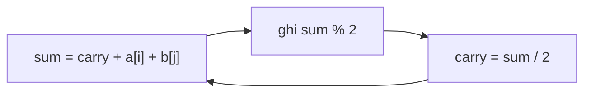

<!-- approaches: Digit-by-digit with carry · BigInteger -->
# 67. Add Binary

**Easy** · Math · String · Bit Manipulation · Simulation · [LeetCode ↗](https://leetcode.com/problems/add-binary/) · Code: [AddBinary.java](AddBinary.java) · Tests: [AddBinaryTest.java](AddBinaryTest.java)

## Đề bài

Cộng hai chuỗi nhị phân, trả về chuỗi nhị phân.

```
"1010" + "1011" -> "10101"
```

## Ý tưởng

> Cộng như ở tiểu học, nhưng **cơ số 2**: từ phải sang, `sum = a + b + nhớ`, ghi `sum % 2`, nhớ `sum / 2`.

```
   1 0 1 0
 + 1 0 1 1
 ---------
 1 0 1 0 1
```

| vị trí (từ phải) | a | b | nhớ vào | sum | ghi | nhớ ra |
|---|---|---|---|---|---|---|
| 0 | 0 | 1 | 0 | 1 | 1 | 0 |
| 1 | 1 | 1 | 0 | 2 | 0 | 1 |
| 2 | 0 | 0 | 1 | 1 | 1 | 0 |
| 3 | 1 | 1 | 0 | 2 | 0 | 1 |
| 4 | | | 1 | 1 | 1 | 0 |



## Cách 1 — Từng chữ số có nhớ ⭐

Ghi vào `StringBuilder` rồi **đảo** một lần ở cuối (chèn vào đầu mỗi lần là `O(n²)`).

## Cách 2 — `BigInteger(s, 2)`

Không được dùng `Integer.parseInt` / `Long.parseLong`: chuỗi dài tới 10⁴ bit.

## Bài liên quan

2 Add Two Numbers · 415 Add Strings · 66 Plus One · 43 Multiply Strings.
