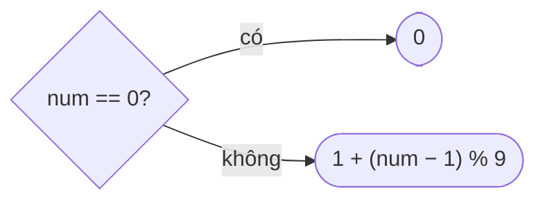

<!-- approaches: Simulate · Digital root formula -->
# 258. Add Digits

**Easy** · Math · Simulation · Number Theory · [LeetCode ↗](https://leetcode.com/problems/add-digits/) · Code: [AddDigits.java](AddDigits.java) · Tests: [AddDigitsTest.java](AddDigitsTest.java)

## Đề bài

Cộng các chữ số của `num`, lặp lại tới khi còn một chữ số. Follow-up: `O(1)`, không vòng lặp.

```
38 -> 3 + 8 = 11 -> 1 + 1 = 2
```

## Ý tưởng

> `10 ≡ 1 (mod 9)` nên `10ᵏ ≡ 1`, do đó một số và **tổng chữ số** của nó có **cùng số dư khi chia 9**.
> Lặp lại tới một chữ số vẫn giữ số dư đó → kết quả là `num mod 9`, trừ trường hợp chia hết thì là `9` (và `0 → 0`).

```
38 = 3·10 + 8 ≡ 3·1 + 8 = 11 ≡ 1 + 1 = 2   (mod 9)
```

| num | 9 | 10 | 18 | 38 | 99 |
|---|---|---|---|---|---|
| kết quả | 9 | 1 | 9 | 2 | 9 |



## Cách 1 — Mô phỏng `O(log n)`

## Cách 2 — Digital root `O(1)` ⭐

`1 + (num − 1) % 9` gộp hai trường hợp "dư 0 → 9" và "dư r → r" thành một công thức.

## Bài liên quan

202 Happy Number · 258 là ví dụ điển hình của "tìm quy luật toán học thay cho mô phỏng".
