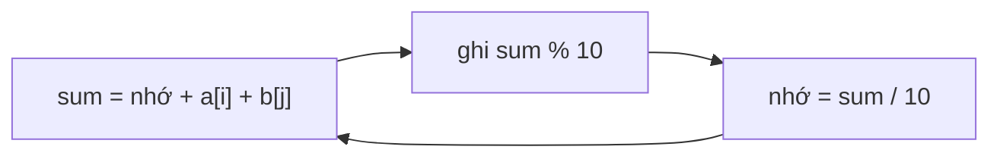

<!-- approaches: Digit-by-digit addition from the right -->
# 415. Add Strings

**Easy** · Math · String · Simulation · [LeetCode ↗](https://leetcode.com/problems/add-strings/) · Code: [AddStrings.java](AddStrings.java) · Tests: [AddStringsTest.java](AddStringsTest.java)

## Đề bài

Cộng hai số nguyên không âm cho dưới dạng chuỗi, **không** chuyển sang kiểu số.

```
"456" + "77" -> "533"
```

## Ý tưởng

> Cộng tay từ **hàng đơn vị**: `sum = chữ số a + chữ số b + nhớ`, ghi `sum % 10`, nhớ `sum / 10`. Chuỗi ngắn hết trước thì coi như chữ số 0.

| hàng | a | b | nhớ vào | sum | ghi |
|---|---|---|---|---|---|
| đơn vị | 6 | 7 | 0 | 13 | 3 |
| chục | 5 | 7 | 1 | 13 | 3 |
| trăm | 4 | – | 1 | 5 | 5 |



## Lời giải ⭐

Điều kiện `carry > 0` trong vòng lặp lo số nhớ cuối (`"9" + "1" = "10"`). Ghi ngược rồi đảo một lần.

## Bài liên quan

67 Add Binary · 2 Add Two Numbers · 43 Multiply Strings · 66 Plus One.
