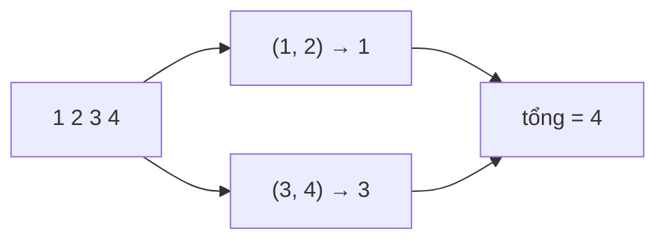

<!-- approaches: Sort · Counting sort -->
# 561. Array Partition

**Easy** · Array · Greedy · Sorting · Counting Sort · [LeetCode ↗](https://leetcode.com/problems/array-partition/) · Code: [ArrayPartition.java](ArrayPartition.java) · Tests: [ArrayPartitionTest.java](ArrayPartitionTest.java)

## Đề bài

Ghép `2n` số thành `n` cặp sao cho tổng các `min(a, b)` lớn nhất.

```
[1,4,3,2] -> 4     (1,2) và (3,4): 1 + 3
```

## Ý tưởng

> Số **nhỏ nhất** luôn là `min` của cặp chứa nó — nó chắc chắn "mất" bạn cặp. Để mất ít nhất, ghép nó với số **nhỏ thứ hai** (phí ít nhất một số lớn). Lặp lại → **sắp xếp và ghép hàng xóm**.



So sánh: ghép `(1, 4), (2, 3)` chỉ được `1 + 2 = 3` — số `4` bị "lãng phí" cạnh số `1`.

## Cách 1 — Sắp xếp `O(n log n)` ⭐

Kết quả = tổng các phần tử ở **chỉ số chẵn** sau khi sắp xếp.

## Cách 2 — Counting sort `O(n + R)`

Giá trị bị chặn trong `[−10⁴, 10⁴]` → đếm, rồi đi theo giá trị tăng dần, lấy xen kẽ.

## Bài liên quan

881 Boats to Save People · 1877 Minimize Maximum Pair Sum in Array (ghép nhỏ nhất với lớn nhất).
