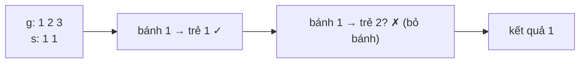

<!-- approaches: Sort + greedy two pointers · Greedy from the biggest cookie -->
# 455. Assign Cookies

**Easy** · Array · Two Pointers · Greedy · Sorting · [LeetCode ↗](https://leetcode.com/problems/assign-cookies/) · Code: [AssignCookies.java](AssignCookies.java) · Tests: [AssignCookiesTest.java](AssignCookiesTest.java)

## Đề bài

Trẻ `i` vui nếu nhận bánh có kích thước `≥ g[i]`. Mỗi trẻ nhận tối đa một bánh. Làm vui **nhiều trẻ nhất**.

```
g = [1,2], s = [1,2,3] -> 2
```

## Ý tưởng

> **Tham lam**: đừng phí bánh to cho trẻ dễ tính. Sắp xếp cả hai, rồi đưa mỗi bánh (từ nhỏ đến lớn) cho **trẻ dễ tính nhất** còn lại — nếu đủ.
> Bánh không đủ cho trẻ dễ tính nhất thì cũng không đủ cho ai → bỏ bánh đó.



## Cách 1 — Bánh nhỏ cho trẻ dễ tính `O(n log n)` ⭐

## Cách 2 — Bánh to cho trẻ khó tính

Từ phía ngược lại: bánh to nhất đưa cho trẻ khó tính nhất mà nó làm vui được; trẻ nào quá khó thì bỏ qua.

## Vì sao tham lam đúng?

Giả sử một cách chia tối ưu đưa bánh nhỏ nhất đủ dùng cho trẻ khác (hoặc không dùng). Đổi chỗ để trẻ dễ tính nhất nhận nó: không trẻ nào mất vui. Lặp lại → cách chia tham lam cũng tối ưu (lập luận **trao đổi** — exchange argument). Test kiểm chứng bằng vét cạn.

## Bài liên quan

881 Boats to Save People · 135 Candy (Hard) · 2410 Maximum Matching of Players With Trainers.
