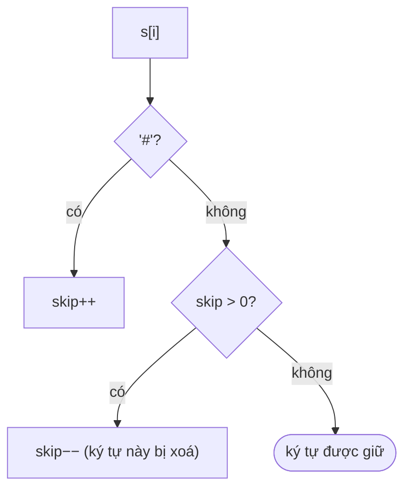

<!-- approaches: Build both with a stack · Two pointers from the end (O(1) space) -->
# 844. Backspace String Compare

**Easy** · Two Pointers · String · Stack · Simulation · [LeetCode ↗](https://leetcode.com/problems/backspace-string-compare/) · Code: [BackspaceStringCompare.java](BackspaceStringCompare.java) · Tests: [BackspaceStringCompareTest.java](BackspaceStringCompareTest.java)

## Đề bài

`#` là phím xoá lùi. Gõ `s` và `t` vào hai trình soạn thảo trống; kết quả có giống nhau không?

```
"ab#c" vs "ad#c" -> true   (cả hai thành "ac")
```

## Ý tưởng

> Ký tự cuối cùng còn lại chỉ phụ thuộc vào các `#` **phía sau** nó → đọc **từ phải sang trái**, đếm số `#` cần "bỏ qua".

`"ab##"` đọc ngược: `#` (skip 1), `#` (skip 2), `b` (bị xoá, skip 1), `a` (bị xoá, skip 0) → rỗng.



## Cách 1 — Gõ ra bằng stack `O(m+n)` bộ nhớ

## Cách 2 — Hai con trỏ từ cuối `O(1)` bộ nhớ ⭐

Mỗi bước tìm ký tự **được giữ** tiếp theo ở cả hai chuỗi rồi so sánh. Một chuỗi hết mà chuỗi kia còn → khác nhau.

## Bài liên quan

1047 Remove All Adjacent Duplicates In String · 1598 Crawler Log Folder · 71 Simplify Path.
