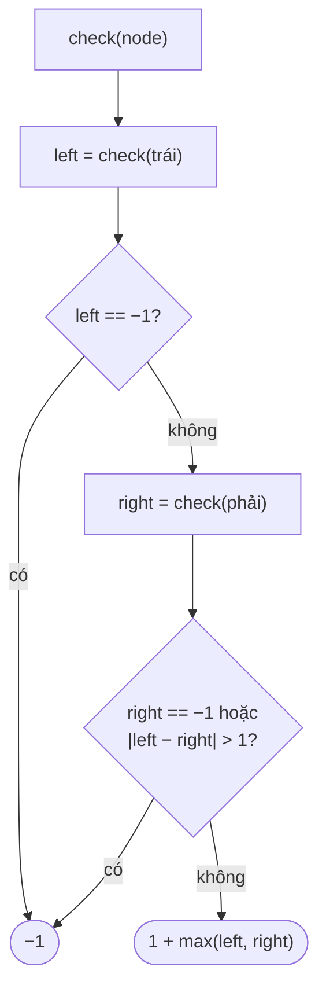

<!-- approaches: Height at every node (top-down) · Bottom-up with -1 sentinel -->
# 110. Balanced Binary Tree

**Easy** · Tree · Depth-First Search · Binary Tree · [LeetCode ↗](https://leetcode.com/problems/balanced-binary-tree/) · Code: [BalancedBinaryTree.java](BalancedBinaryTree.java) · Tests: [BalancedBinaryTreeTest.java](BalancedBinaryTreeTest.java)

## Đề bài

Cây có **cân bằng chiều cao** không — tại **mọi** node, chiều cao hai cây con chênh nhau tối đa 1?

```
    3                  1
   / \                / \
  9  20     true     2   2      false (node 2 trái: cao 2 vs 0)
    /  \            / \
   15   7          3   3
                  / \
                 4   4
```

## Ý tưởng

> Tính chiều cao **từ dưới lên** và kiểm tra cân bằng ngay tại mỗi node. Dùng giá trị đặc biệt `−1` để báo "đã mất cân bằng" và **dừng sớm**.



## Cách 1 — Từ trên xuống `O(n²)` xấu nhất

Ở mỗi node gọi `height` cho hai cây con, rồi đệ quy kiểm tra tiếp → chiều cao bị tính lại nhiều lần.

## Cách 2 — Từ dưới lên, một lượt `O(n)` ⭐

Mỗi node được thăm đúng một lần; chiều cao và trạng thái cân bằng được trả về **cùng lúc** (gói trong một số nguyên).

## Bẫy & lưu ý

- Chỉ kiểm tra ở **gốc** là sai: hai cây con của gốc có thể cao bằng nhau nhưng bên trong lệch (test có ca này).

## Bài liên quan

104 Maximum Depth · 543 Diameter of Binary Tree · 108 Convert Sorted Array to BST · 1382 Balance a BST.
