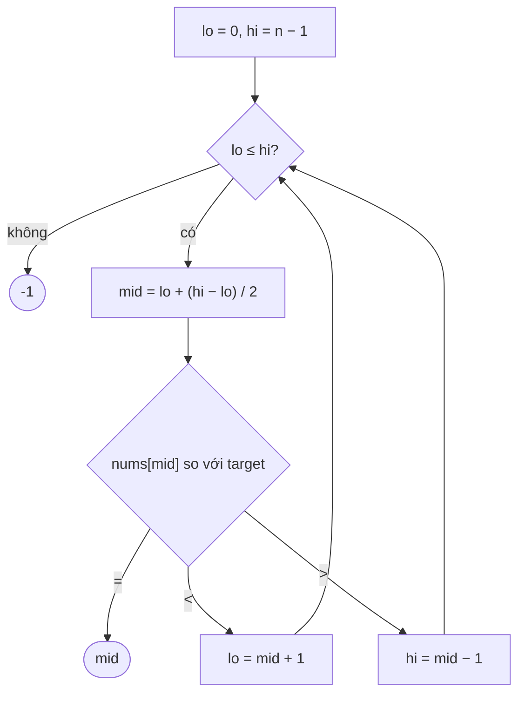

<!-- approaches: Closed interval · Half-open interval · Recursive -->
# 704. Binary Search

**Easy** · Array · Binary Search · [LeetCode ↗](https://leetcode.com/problems/binary-search/) · Code: [BinarySearch.java](BinarySearch.java) · Tests: [BinarySearchTest.java](BinarySearchTest.java)

## Đề bài

Mảng tăng dần, các phần tử khác nhau. Tìm chỉ số của `target` trong `O(log n)`, không có → `−1`.

```
[-1,0,3,5,9,12], 9 -> 4
```

## Ý tưởng

> So `target` với phần tử **giữa**: nhỏ hơn thì đáp án chỉ có thể ở nửa trái, lớn hơn thì ở nửa phải. Mỗi bước **loại một nửa** → `log₂ n` bước (10⁴ phần tử chỉ cần ~14 bước).



`[-1, 0, 3, 5, 9, 12]`, target = 9:

| lo | hi | mid | nums[mid] | |
|---|---|---|---|---|
| 0 | 5 | 2 | 3 | < 9 → lo = 3 |
| 3 | 5 | 4 | 9 | **tìm thấy** |

## Cách 1 — Khoảng đóng `[lo, hi]` ⭐

Điều kiện `lo <= hi`; cập nhật `mid ± 1`.

## Cách 2 — Khoảng nửa mở `[lo, hi)`

Tìm vị trí đầu tiên `≥ target` (lower bound) rồi kiểm tra. Khuôn này mạnh hơn: dùng cho mọi bài "tìm ranh giới" (35, 34, 278).

## Cách 3 — Đệ quy

## Hai khuôn — đừng trộn lẫn

| | khoảng đóng | nửa mở |
|---|---|---|
| khởi tạo | `hi = n − 1` | `hi = n` |
| điều kiện | `lo <= hi` | `lo < hi` |
| đi trái | `hi = mid − 1` | `hi = mid` |

Trộn hai khuôn (ví dụ `hi = n` với `lo <= hi`) là nguồn gốc của lỗi vòng lặp vô hạn hoặc truy cập ngoài mảng.

## Bài liên quan

35 Search Insert Position · 34 Find First and Last Position · 33 Search in Rotated Sorted Array · 278 First Bad Version.
