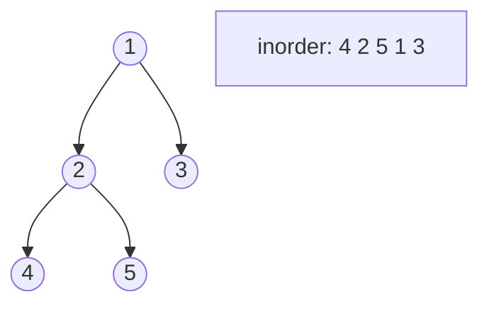

<!-- approaches: Recursive · Iterative stack · Morris -->
# 94. Binary Tree Inorder Traversal

**Easy** · Stack · Tree · Depth-First Search · Binary Tree · [LeetCode ↗](https://leetcode.com/problems/binary-tree-inorder-traversal/) · Code: [BinaryTreeInorderTraversal.java](BinaryTreeInorderTraversal.java) · Tests: [BinaryTreeInorderTraversalTest.java](BinaryTreeInorderTraversalTest.java)

## Đề bài

Duyệt cây nhị phân theo thứ tự **giữa** (inorder): trái → gốc → phải.

```
    1
     \
      2        ->  [1, 3, 2]
     /
    3
```

## Ý tưởng

> Inorder trên **BST** cho ra dãy **tăng dần** — vì vậy nó là công cụ cho rất nhiều bài BST (98, 230, 99).
> Ba cách cài đặt khác nhau ở chỗ **ai nhớ đường quay lại**: stack của hệ thống, stack tự quản, hay chính cây (Morris).



## Cách 1 — Đệ quy `O(n) · O(h)`

Ba dòng: `visit(left); add(val); visit(right)`.

## Cách 2 — Stack tự quản `O(n) · O(h)` ⭐

1. Đi **trái hết mức**, đẩy từng node vào stack.
2. `pop` một node → ghi giá trị → chuyển sang cây con **phải** của nó.
3. Lặp tới khi `curr == null` và stack rỗng.

Cây trên:

| thao tác | stack | out |
|---|---|---|
| đẩy 1, 2, 4 | 1 2 4 | |
| pop 4 (không có phải) | 1 2 | 4 |
| pop 2 → sang 5, đẩy 5 | 1 5 | 4 2 |
| pop 5 | 1 | 4 2 5 |
| pop 1 → sang 3, đẩy 3 | 3 | 4 2 5 1 |
| pop 3 | | 4 2 5 1 3 |

## Cách 3 — Morris `O(n) · O(1)`

Với node có cây con trái, tìm **node đứng ngay trước** nó (nút phải nhất của cây con trái) và tạm nối `pred.right = curr`. Đi xuống trái; khi quay lại qua sợi nối này lần hai thì gỡ nó ra và ghi `curr`. Cây được **khôi phục nguyên vẹn** (test kiểm tra điều đó).

## Bẫy & lưu ý

- Cây lệch cao `n` → đệ quy có thể tràn stack với `n` lớn; cách 2 an toàn hơn.
- Morris sửa cây tạm thời — không dùng khi nhiều luồng đọc cùng cây.

## Bài liên quan

144 Preorder · 145 Postorder · 102 Level Order · 98 Validate BST · 230 Kth Smallest Element in a BST · 173 BST Iterator.
