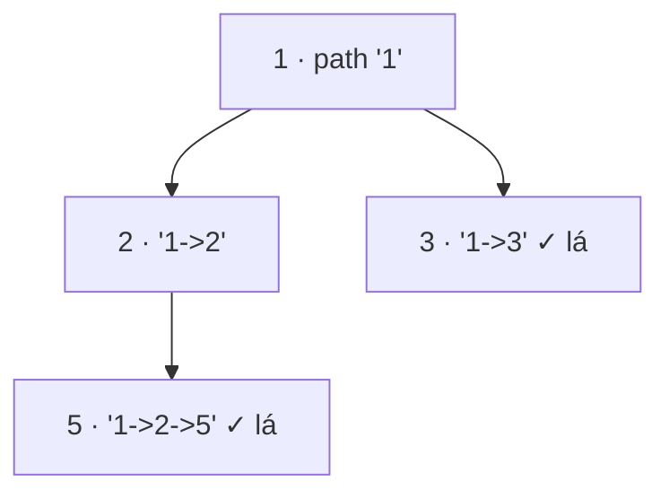

<!-- approaches: DFS with string building · DFS with backtracking · BFS -->
# 257. Binary Tree Paths

**Easy** · String · Backtracking · Tree · Depth-First Search · [LeetCode ↗](https://leetcode.com/problems/binary-tree-paths/) · Code: [BinaryTreePaths.java](BinaryTreePaths.java) · Tests: [BinaryTreePathsTest.java](BinaryTreePathsTest.java)

## Đề bài

Liệt kê mọi đường đi từ **gốc tới lá** dưới dạng chuỗi `"1->2->5"`.

```
    1
   / \
  2   3      -> ["1->2->5", "1->3"]
   \
    5
```

## Ý tưởng

> DFS mang theo **đường đi hiện tại**. Tới **lá** (không có con nào) thì ghi lại đường đi.



## Cách 1 — Truyền chuỗi bất biến ⭐ (dễ viết nhất)

Mỗi lời gọi tạo chuỗi mới `path + val` — không cần "hoàn tác", vì mỗi nhánh có bản sao riêng.

## Cách 2 — Backtracking với một `StringBuilder`

Ghi nhớ độ dài trước khi thêm, sau khi xử lý xong hai con thì `setLength(len)` để **trả lại** trạng thái cũ. Tiết kiệm bộ nhớ hơn — khuôn mẫu chung cho mọi bài "liệt kê đường đi".

## Cách 3 — BFS

Hàng đợi chứa cặp `(node, đường đi tới node)`.

## Bẫy & lưu ý

- **Lá** là node không có **cả hai** con — node chỉ thiếu một con không phải lá.
- Giá trị âm: `"-10->-30"` — đừng tách chuỗi theo dấu `-`.

## Bài liên quan

112 Path Sum · 113 Path Sum II · 129 Sum Root to Leaf Numbers · 988 Smallest String Starting From Leaf.
