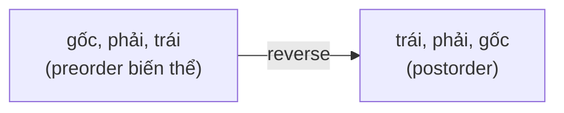

<!-- approaches: Recursive · Reversed modified preorder · One stack with last-visited -->
# 145. Binary Tree Postorder Traversal

**Easy** · Stack · Tree · Depth-First Search · Binary Tree · [LeetCode ↗](https://leetcode.com/problems/binary-tree-postorder-traversal/) · Code: [BinaryTreePostorderTraversal.java](BinaryTreePostorderTraversal.java) · Tests: [BinaryTreePostorderTraversalTest.java](BinaryTreePostorderTraversalTest.java)

## Đề bài

Duyệt cây theo thứ tự **sau** (postorder): trái → phải → gốc.

```
    1
     \
      2        ->  [3, 2, 1]
     /
    3
```

## Ý tưởng

> Postorder xử lý node **sau khi** xong cả hai cây con — đúng thứ tự cần khi tính thứ gì đó **từ dưới lên** (chiều cao, kích thước, xoá cây, đường kính…).

## Cách 1 — Đệ quy

## Cách 2 — Preorder "ngược" rồi đảo kết quả ⭐ (dễ nhớ)

Preorder thường: gốc → trái → phải. Đẩy con trái **trước** con phải vào stack thì được gốc → **phải** → trái. Đảo ngược cả dãy: trái → phải → gốc = postorder.



## Cách 3 — Một stack, nhớ node vừa xuất `O(h)`

Đi trái hết mức. Nhìn đỉnh stack: nếu có con phải **chưa xử lý** thì đi sang phải; ngược lại xuất node. "Con phải đã xử lý" ⇔ node vừa xuất (`lastVisited`) chính là con phải đó.

| đỉnh | right | lastVisited | hành động |
|---|---|---|---|
| 1 | 2 | – | sang 2, đẩy 2, 3 |
| 3 | – | – | xuất 3 |
| 2 | – | 3 | xuất 2 |
| 1 | 2 | 2 | xuất 1 |

Cách này mới thật sự là "duyệt postorder" (cách 2 chỉ cho ra đúng **dãy**), cần khi phải xử lý node đúng lúc.

## Bài liên quan

94 Inorder · 144 Preorder · 104 Maximum Depth · 543 Diameter of Binary Tree · 124 Binary Tree Maximum Path Sum.
