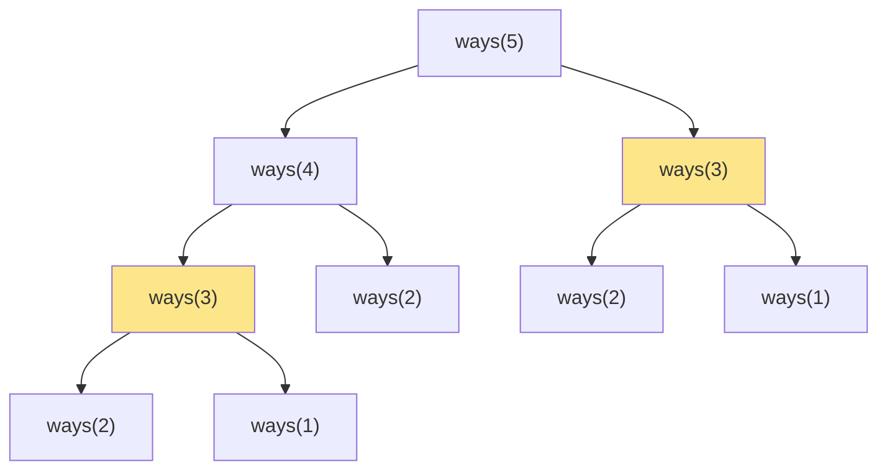
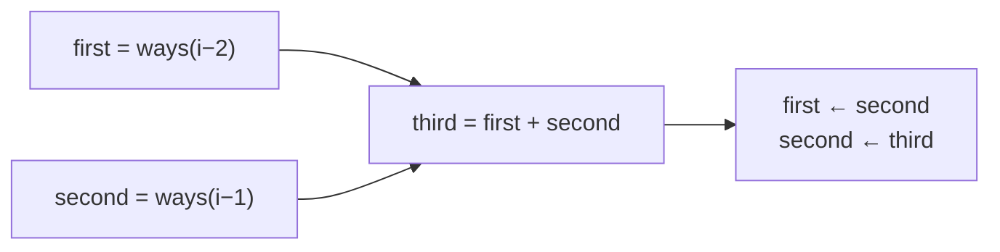

<!-- approaches: Recursion · Memoization · DP table · Two variables -->
# 70. Climbing Stairs

**Easy** · Math · Dynamic Programming · Memoization · [LeetCode ↗](https://leetcode.com/problems/climbing-stairs/) · Code: [ClimbingStairs.java](ClimbingStairs.java) · Tests: [ClimbingStairsTest.java](ClimbingStairsTest.java)

## Đề bài

Cầu thang `n` bậc, mỗi lần bước **1 hoặc 2** bậc. Có bao nhiêu cách lên tới đỉnh?

```
n = 2 -> 2   (1+1, 2)
n = 3 -> 3   (1+1+1, 1+2, 2+1)
```

## Ý tưởng

> Bước **cuối cùng** lên bậc `n` chỉ có thể từ bậc `n−1` (bước 1) hoặc bậc `n−2` (bước 2).
> Nên `ways(n) = ways(n−1) + ways(n−2)` — chính là dãy **Fibonacci**.

Đây là bài nhập môn **quy hoạch động (DP)**: chia bài lớn thành bài con chồng lặp, nhớ kết quả bài con.

## Cách 1 — Đệ quy thuần `O(2ⁿ)`

Viết thẳng công thức. Cây gọi phình ra theo cấp số nhân vì cùng một bài con bị tính lại nhiều lần:



`ways(3)` (tô vàng) bị tính **hai lần**; với n = 45 là hàng tỉ lần gọi.

## Cách 2 — Đệ quy có nhớ (top-down) `O(n) · O(n)`

Giữ nguyên đệ quy, thêm `cache`: tính xong `ways(k)` thì lưu lại, lần sau lấy ra luôn. Mỗi `k` chỉ tính một lần.

## Cách 3 — Bảng DP (bottom-up) `O(n) · O(n)`

Đi từ dưới lên: `dp[1] = 1, dp[2] = 2, dp[i] = dp[i−1] + dp[i−2]`.

| i | 1 | 2 | 3 | 4 | 5 | 6 |
|---|---|---|---|---|---|---|
| dp[i] | 1 | 2 | 3 | 5 | 8 | 13 |

## Cách 4 — Hai biến `O(n) · O(1)` ⭐

`dp[i]` chỉ cần hai giá trị trước → giữ `first`, `second` rồi "trượt" lên.



## So sánh

| Cách | Thời gian | Bộ nhớ |
|---|---|---|
| Đệ quy | O(2ⁿ) | O(n) stack |
| Có nhớ | O(n) | O(n) |
| Bảng | O(n) | O(n) |
| Hai biến | **O(n)** | **O(1)** |

## Bẫy & lưu ý

- `n = 1` → 1, `n = 2` → 2: xử lý trước để không truy cập `dp[2]` khi mảng chỉ có 2 phần tử.
- `n ≤ 45` vừa đủ trong `int` (1 836 311 903); lớn hơn phải dùng `long` hoặc `BigInteger`.
- Follow-up hay gặp: bước được `{1, 3, 5}`? → `ways(n) = Σ ways(n − s)` với mọi bước `s`. Có thể tính `O(log n)` bằng luỹ thừa ma trận.

## Bài liên quan

746 Min Cost Climbing Stairs · 509 Fibonacci Number · 198 House Robber · 91 Decode Ways.
