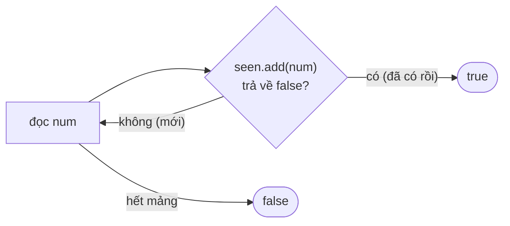

<!-- approaches: Brute force · Sort · Hash set -->
# 217. Contains Duplicate

**Easy** · Array · Hash Table · Sorting · [LeetCode ↗](https://leetcode.com/problems/contains-duplicate/) · Code: [ContainsDuplicate.java](ContainsDuplicate.java) · Tests: [ContainsDuplicateTest.java](ContainsDuplicateTest.java)

## Đề bài

Mảng có giá trị nào xuất hiện **từ hai lần trở lên** không?

```
[1,2,3,1] -> true        [1,2,3,4] -> false
```

## Ý tưởng

> "Đã gặp giá trị này chưa?" là câu hỏi tra cứu → **HashSet** trả lời trong `O(1)`.
> Hoặc: sau khi **sắp xếp**, hai giá trị bằng nhau sẽ nằm cạnh nhau.

## Cách 1 — Vét cạn `O(n²) · O(1)`

So mọi cặp `(i, j)`. Dùng làm chuẩn để test.

## Cách 2 — Sắp xếp `O(n log n) · O(1)` (nếu sắp xếp tại chỗ)

```
[1, 2, 3, 1]  --sort-->  [1, 1, 2, 3]
                           ^  ^  hàng xóm bằng nhau -> true
```

Hợp khi bộ nhớ bị giới hạn. Lưu ý sắp xếp tại chỗ **làm thay đổi** mảng đầu vào — code dùng bản sao.

## Cách 3 — HashSet `O(n) · O(n)` ⭐



Mẹo: `Set.add` trả về `false` khi phần tử **đã tồn tại** → không cần gọi `contains` riêng.

## So sánh

| Cách | Thời gian | Bộ nhớ | Ghi chú |
|---|---|---|---|
| Vét cạn | O(n²) | O(1) | |
| Sắp xếp | O(n log n) | O(1)* | *nếu được sửa mảng |
| HashSet | **O(n)** | O(n) | Dừng sớm ngay khi thấy trùng |

## Bẫy & lưu ý

- Mảng rỗng / một phần tử → `false`.
- Một dòng `Arrays.stream(nums).distinct().count() < nums.length` cũng đúng nhưng không dừng sớm.

## Bài liên quan

219 Contains Duplicate II (trong khoảng `k`) · 220 Contains Duplicate III · 287 Find the Duplicate Number.
