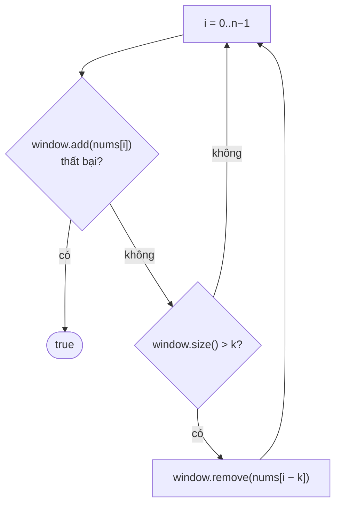

<!-- approaches: Brute force · Last index map · Sliding window set -->
# 219. Contains Duplicate II

**Easy** · Array · Hash Table · Sliding Window · [LeetCode ↗](https://leetcode.com/problems/contains-duplicate-ii/) · Code: [ContainsDuplicateII.java](ContainsDuplicateII.java) · Tests: [ContainsDuplicateIITest.java](ContainsDuplicateIITest.java)

## Đề bài

Có hai chỉ số khác nhau `i, j` với `nums[i] == nums[j]` và `|i − j| ≤ k` không?

```
[1,2,3,1],     k = 3 -> true   (chỉ số 0 và 3)
[1,2,3,1,2,3], k = 2 -> false  (mỗi cặp bằng nhau cách nhau 3)
```

## Ý tưởng

> Chỉ cần quan tâm tới **k phần tử gần nhất** phía trước → một **cửa sổ trượt** dài `k`.

## Cách 1 — Vét cạn `O(n·k)`

Với mỗi `i`, xét `k` phần tử tiếp theo.

## Cách 2 — Nhớ chỉ số gần nhất `O(n) · O(n)`

`lastIndex[value]` = lần cuối thấy giá trị đó. Gặp lại thì so khoảng cách. Chỉ cần lần **gần nhất** vì nó cho khoảng cách nhỏ nhất.
Mẹo: `map.put` trả về giá trị cũ → vừa ghi vừa đọc trong một lệnh.

## Cách 3 — Cửa sổ trượt với HashSet `O(n) · O(k)` ⭐

Set luôn chứa đúng `k` giá trị gần nhất. Thêm `nums[i]` thất bại → trùng trong cửa sổ.



Chạy tay `[1,2,3,1,2,3], k = 2`:

| i | nums[i] | window sau khi xử lý |
|---|---|---|
| 0 | 1 | {1} |
| 1 | 2 | {1,2} |
| 2 | 3 | {1,2,3} → bỏ nums[0]=1 → {2,3} |
| 3 | 1 | {2,3,1} → bỏ 2 → {3,1} |
| 4 | 2 | {3,1,2} → bỏ 3 → {1,2} |
| 5 | 3 | {1,2,3} → bỏ 1 → {2,3} → **false** |

## Bẫy & lưu ý

- `k = 0` → luôn `false` (cần hai chỉ số **khác nhau**). Cách 3 vẫn đúng: thêm xong set có 1 phần tử > 0 → xoá ngay.
- Phần tử bị xoá là `nums[i − k]`, không phải `nums[i − k − 1]` — vẽ thử với k = 1 để kiểm tra.

## Bài liên quan

217 Contains Duplicate · 220 Contains Duplicate III (dùng TreeSet / bucket) · 3 Longest Substring Without Repeating Characters.
