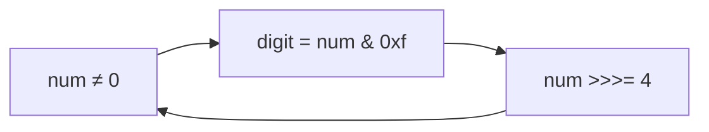

<!-- approaches: Nibble by nibble with unsigned shift · Integer.toHexString -->
# 405. Convert a Number to Hexadecimal

**Easy** · Math · String · Bit Manipulation · [LeetCode ↗](https://leetcode.com/problems/convert-a-number-to-hexadecimal/) · Code: [ConvertANumberToHexadecimal.java](ConvertANumberToHexadecimal.java) · Tests: [ConvertANumberToHexadecimalTest.java](ConvertANumberToHexadecimalTest.java)

## Đề bài

Đổi số nguyên 32-bit sang hệ 16 (chữ thường, không có số 0 đứng đầu). Số âm dùng **bù hai**.

```
26 -> "1a"      -1 -> "ffffffff"
```

## Ý tưởng

> Mỗi chữ số hex = **4 bit** (một nibble). Lấy 4 bit thấp bằng `num & 0xf`, rồi dịch phải 4 bit — lặp tới khi hết.
> Dùng `>>>` (dịch **không dấu**): với số âm, `>>` kéo bit dấu vào nên lặp vô hạn; `>>>` kéo số 0 vào nên dừng sau đúng 8 nibble.

```
26 = 0001 1010
          ^^^^ 1010 = a
     ^^^^      0001 = 1      -> "1a"
```



## Cách 1 — Từng nibble ⭐

## Cách 2 — `Integer.toHexString`

## Bài liên quan

504 Base 7 · 168 Excel Sheet Column Title · 190 Reverse Bits.
