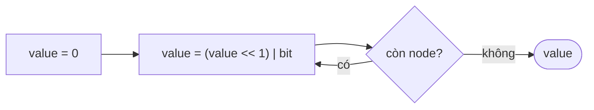

<!-- approaches: Shift and add · Collect then parse -->
# 1290. Convert Binary Number in a Linked List to Integer

**Easy** · Linked List · Math · [LeetCode ↗](https://leetcode.com/problems/convert-binary-number-in-a-linked-list-to-integer/) · Code: [ConvertBinaryNumberInALinkedListToInteger.java](ConvertBinaryNumberInALinkedListToInteger.java) · Tests: [ConvertBinaryNumberInALinkedListToIntegerTest.java](ConvertBinaryNumberInALinkedListToIntegerTest.java)

## Đề bài

Danh sách liên kết chứa các bit của một số nhị phân (bit cao nhất đứng đầu). Trả về giá trị thập phân.

```
1 → 0 → 1  ->  5
```

## Ý tưởng

> Đọc từ trái sang phải giống đọc số thập phân "1, 12, 123": mỗi chữ số mới **dịch các chữ số cũ lên một hàng** rồi cộng vào.
> Hệ nhị phân: `value = value · 2 + bit` (quy tắc **Horner**), viết bằng bit: `(value << 1) | bit`.

| bit | value |
|---|---|
| 1 | 0·2 + 1 = 1 |
| 0 | 1·2 + 0 = 2 |
| 1 | 2·2 + 1 = **5** |



## Cách 1 — Dịch và cộng `O(n) · O(1)` ⭐

## Cách 2 — Gom chuỗi rồi `parseInt(s, 2)` `O(n) · O(n)`

## Bẫy & lưu ý

- Tối đa 30 node nên vừa `int`.
- Cùng kỹ thuật đọc số từ chuỗi chữ số: `value = value · 10 + digit` (bài 8 atoi).

## Bài liên quan

8 String to Integer (atoi) · 67 Add Binary · 2 Add Two Numbers.
