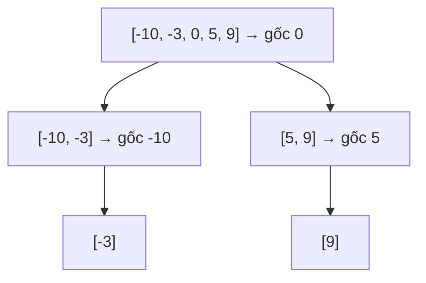

<!-- approaches: Recursive middle split · Iterative with a stack -->
# 108. Convert Sorted Array to Binary Search Tree

**Easy** · Array · Divide and Conquer · Tree · Binary Search Tree · [LeetCode ↗](https://leetcode.com/problems/convert-sorted-array-to-binary-search-tree/) · Code: [ConvertSortedArrayToBinarySearchTree.java](ConvertSortedArrayToBinarySearchTree.java) · Tests: [ConvertSortedArrayToBinarySearchTreeTest.java](ConvertSortedArrayToBinarySearchTreeTest.java)

## Đề bài

Biến mảng **đã sắp xếp tăng** thành một **BST cân bằng chiều cao** (độ sâu hai cây con của mọi node chênh nhau tối đa 1).

```
[-10,-3,0,5,9]  ->       0
                        / \
                     -10   5
                        \    \
                        -3    9
```

## Ý tưởng

> Phần tử **giữa** làm gốc: nửa trái (nhỏ hơn) thành cây con trái, nửa phải thành cây con phải — đúng tính chất BST, và hai nửa có kích thước chênh nhau tối đa 1 → cân bằng. Lặp lại cho từng nửa.



## Cách 1 — Đệ quy chia đôi `O(n) · O(log n)` ⭐

Giống tìm kiếm nhị phân nhưng **đi cả hai nhánh**. Mỗi phần tử thành đúng một node.

## Cách 2 — Lặp với stack

Mỗi phần tử stack là một "việc": node đã tạo + đoạn `[lo, hi]` nó phụ trách. Dùng `record` của Java cho gọn.

## Bẫy & lưu ý

- Có nhiều đáp án đúng (chọn giữa lệch trái hay lệch phải khi độ dài chẵn). Test kiểm tra **tính chất** (cân bằng + inorder bằng mảng gốc) thay vì so một cây cụ thể.

## Bài liên quan

109 Convert Sorted List to BST · 110 Balanced Binary Tree · 1382 Balance a Binary Search Tree.
