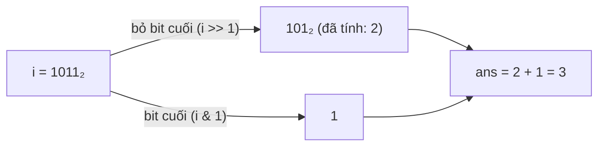

<!-- approaches: Count each number · DP with i >> 1 · DP with i & (i - 1) -->
# 338. Counting Bits

**Easy** · Dynamic Programming · Bit Manipulation · [LeetCode ↗](https://leetcode.com/problems/counting-bits/) · Code: [CountingBits.java](CountingBits.java) · Tests: [CountingBitsTest.java](CountingBitsTest.java)

## Đề bài

Với mọi `i` từ `0` tới `n`, đếm số bit `1` trong biểu diễn nhị phân của `i`. Follow-up: `O(n)`.

```
n = 5  ->  [0, 1, 1, 2, 1, 2]
```

## Ý tưởng

> Số bit của `i` có thể suy ra từ một số **nhỏ hơn đã tính** → quy hoạch động trên bit.

| i | nhị phân | i >> 1 | i & 1 | ans |
|---|---|---|---|---|
| 4 | 100 | 10 (2) | 0 | ans[2] + 0 = 1 |
| 5 | 101 | 10 (2) | 1 | ans[2] + 1 = 2 |
| 6 | 110 | 11 (3) | 0 | ans[3] + 0 = 2 |
| 7 | 111 | 11 (3) | 1 | ans[3] + 1 = 3 |



## Cách 1 — Đếm từng số `O(n log n)`

Mẹo Brian Kernighan: `x &= x − 1` xoá bit `1` thấp nhất; số vòng lặp = số bit `1`.

## Cách 2 — `ans[i >> 1] + (i & 1)` `O(n)` ⭐

Dịch phải một bit = bỏ bit cuối; số còn lại nhỏ hơn `i` nên đã có đáp án.

## Cách 3 — `ans[i & (i − 1)] + 1` `O(n)`

`i & (i − 1)` là `i` sau khi xoá bit `1` thấp nhất — nhỏ hơn `i` và ít hơn đúng một bit.

## Bài liên quan

191 Number of 1 Bits · 461 Hamming Distance · 231 Power of Two (`n & (n−1) == 0`).
