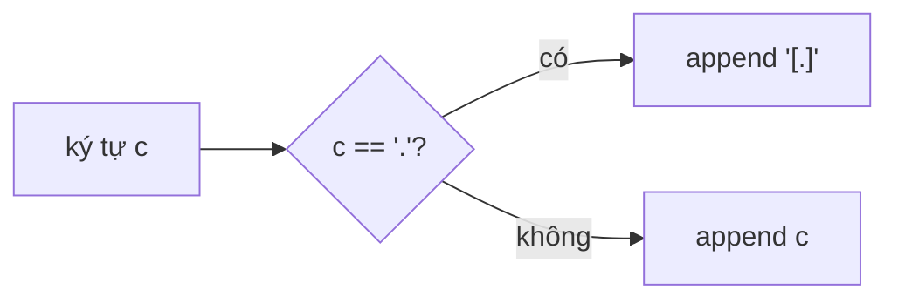

<!-- approaches: String replace · StringBuilder -->
# 1108. Defanging an IP Address

**Easy** · String · [LeetCode ↗](https://leetcode.com/problems/defanging-an-ip-address/) · Code: [DefangingAnIPAddress.java](DefangingAnIPAddress.java) · Tests: [DefangingAnIPAddressTest.java](DefangingAnIPAddressTest.java)

## Đề bài

Thay mỗi dấu `.` trong địa chỉ IPv4 bằng `[.]`.

```
"1.1.1.1" -> "1[.]1[.]1[.]1"
```

## Ý tưởng

> Duyệt từng ký tự: gặp `.` thì ghi `[.]`, còn lại ghi nguyên. Chuỗi trong Java **bất biến**, nên dựng kết quả bằng `StringBuilder`.



## Cách 1 — `String.replace` `O(n)`

Một dòng. Lưu ý `replace` (thay chuỗi thường) khác `replaceAll` (nhận **regex** — `"."` sẽ khớp mọi ký tự!).

## Cách 2 — `StringBuilder` `O(n)` ⭐ khi phỏng vấn

Biết trước độ dài kết quả (`n + 6`, vì IPv4 có đúng 3 dấu chấm) nên cấp phát một lần.

## Bẫy & lưu ý

- `address.replaceAll(".", "[.]")` cho ra toàn `[.]` — bẫy regex kinh điển. Muốn dùng thì phải `replaceAll("\\.", "[.]")`.
- Nối chuỗi bằng `+=` trong vòng lặp là `O(n²)`.

## Bài liên quan

1678 Goal Parser Interpretation · 709 To Lower Case · 468 Validate IP Address.
