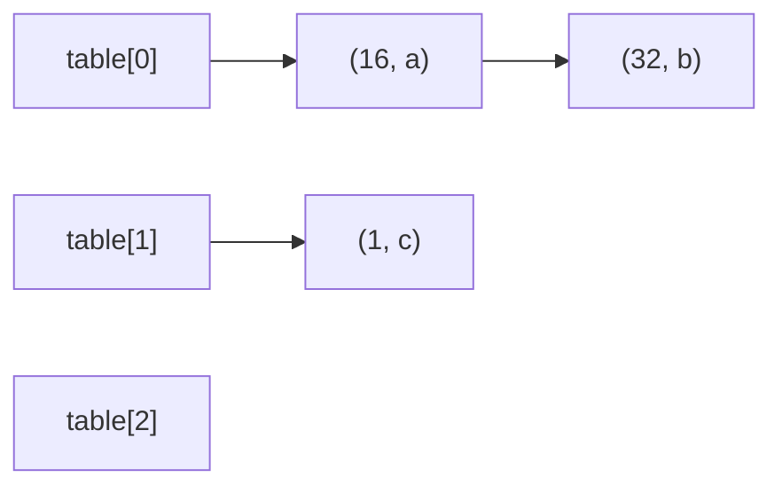

<!-- approaches: Direct-address array · Separate chaining with resize -->
# 706. Design HashMap

**Easy** · Array · Hash Table · Linked List · Design · [LeetCode ↗](https://leetcode.com/problems/design-hashmap/) · Code: [DesignHashMap.java](DesignHashMap.java) · Tests: [DesignHashMapTest.java](DesignHashMapTest.java)

## Đề bài

Tự cài đặt **HashMap** (`put`, `get` trả `−1` nếu không có, `remove`), không dùng thư viện bảng băm.

## Ý tưởng

> Giống 705 Design HashSet, nhưng mỗi phần tử trong xô là cặp **(key, value)**. `put` với key đã có thì **cập nhật** giá trị thay vì thêm mới.

## Cách 1 — Mảng địa chỉ trực tiếp `O(1)`

Một ô cho mỗi khoá có thể, `−1` là "không có". Chỉ khả thi vì khoá ≤ 10⁶.

## Cách 2 — Bucket + danh sách liên kết, tự giãn ⭐

| thao tác | việc |
|---|---|
| `put` | duyệt xô: thấy key → sửa value; không thấy → chèn **đầu** danh sách |
| `get` | duyệt xô tìm key |
| `remove` | dùng node giả `dummy` để xoá cả khi node cần xoá là đầu danh sách |
| giãn | `size > 0.75 × capacity` → gấp đôi, chuyển từng entry sang xô mới |

Kích thước bảng luôn là luỹ thừa của 2, nên `hash & (capacity − 1)` thay cho `%`.

## Câu hỏi mở rộng

- **Open addressing** (dò tuyến tính) thay cho chaining: thân thiện cache hơn, nhưng `remove` cần đánh dấu "bia mộ".
- Nhiều luồng → `ConcurrentHashMap` khoá theo từng xô.

## Bài liên quan

705 Design HashSet · 146 LRU Cache · 981 Time Based Key-Value Store.
