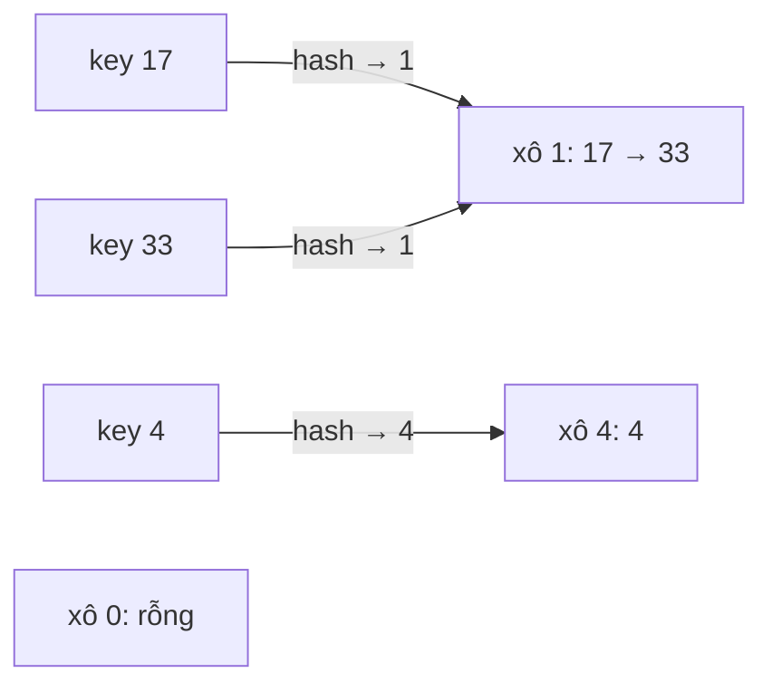

<!-- approaches: Boolean array · Separate chaining -->
# 705. Design HashSet

**Easy** · Array · Hash Table · Linked List · Design · [LeetCode ↗](https://leetcode.com/problems/design-hashset/) · Code: [DesignHashSet.java](DesignHashSet.java) · Tests: [DesignHashSetTest.java](DesignHashSetTest.java)

## Đề bài

Tự cài đặt **HashSet** (`add`, `remove`, `contains`) mà không dùng thư viện bảng băm. Khoá trong `[0, 10⁶]`.

## Ý tưởng

> Bảng băm = **mảng các "xô" (bucket)**. Hàm băm biến khoá thành chỉ số xô; các khoá trùng xô (**va chạm**) được giữ trong một danh sách nhỏ.
> Khi số phần tử vượt `0.75 × số xô` thì **gấp đôi** số xô và chia lại (rehash) để các danh sách luôn ngắn.

## Cách 1 — Mảng boolean `O(1)`

Khoá nhỏ nên có thể dành một ô cho mỗi khoá có thể có. Đơn giản, nhanh, nhưng tốn ~1 MB dù chỉ có vài khoá — và không mở rộng được cho khoá tuỳ ý.

## Cách 2 — Bucket + danh sách liên kết (separate chaining) ⭐

- Số xô là luỹ thừa của 2 → `hash & (capacity − 1)` thay cho phép `%`.
- Nhân với hằng số `0x9E3779B1` (golden ratio) để các khoá liên tiếp không dồn vào xô liền nhau.
- **Load factor 0.75**: vượt ngưỡng thì gấp đôi — chi phí rehash `O(n)` chia đều cho các lần `add` → khấu hao `O(1)`.

Đây chính là cách `java.util.HashMap` làm (từ Java 8, xô quá dài còn chuyển thành cây đỏ-đen).

## Bẫy & lưu ý

- `LinkedList.remove(int)` xoá theo **chỉ số**; phải ép `(Integer) key` để xoá theo **giá trị**.

## Bài liên quan

706 Design HashMap · 146 LRU Cache · 380 Insert Delete GetRandom O(1).
