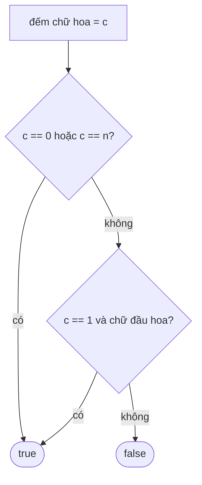

<!-- approaches: Count uppercase · Regex -->
# 520. Detect Capital

**Easy** · String · [LeetCode ↗](https://leetcode.com/problems/detect-capital/) · Code: [DetectCapital.java](DetectCapital.java) · Tests: [DetectCapitalTest.java](DetectCapitalTest.java)

## Đề bài

Cách viết hoa đúng khi: viết hoa **toàn bộ** (`USA`), **không** viết hoa (`leetcode`), hoặc chỉ viết hoa **chữ đầu** (`Google`).

## Ý tưởng

> Đếm số chữ hoa, ba trường hợp đúng tương ứng: `0`, `n`, hoặc `1` và nằm ở vị trí đầu.

## Cách 1 — Đếm chữ hoa ⭐

## Cách 2 — Regex `[A-Z]*|[A-Z]?[a-z]*`

## Bài liên quan

709 To Lower Case · 520 là ví dụ "liệt kê các trường hợp hợp lệ" thay vì tìm trường hợp sai.
