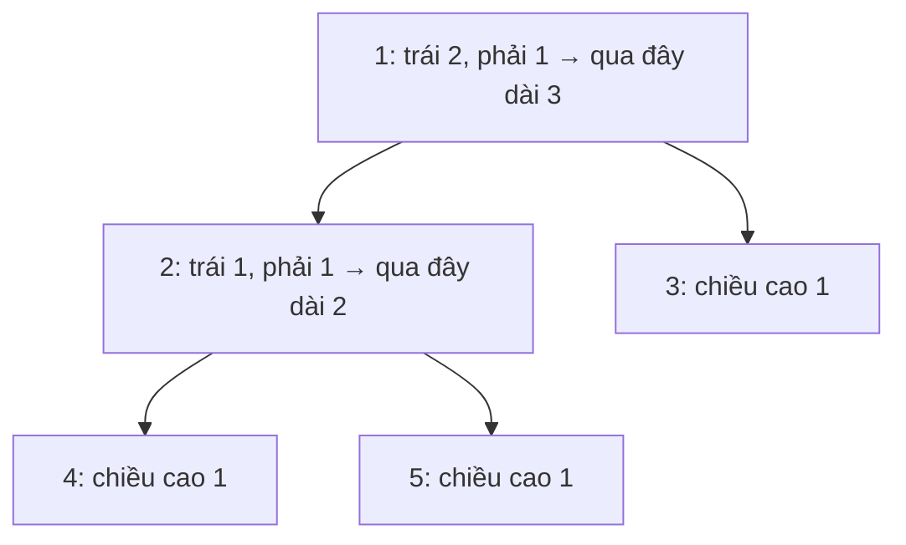

<!-- approaches: Height at every node (O(n²)) · One DFS returning height -->
# 543. Diameter of Binary Tree

**Easy** · Tree · Depth-First Search · Binary Tree · DP on Trees · [LeetCode ↗](https://leetcode.com/problems/diameter-of-binary-tree/) · Code: [DiameterOfBinaryTree.java](DiameterOfBinaryTree.java) · Tests: [DiameterOfBinaryTreeTest.java](DiameterOfBinaryTreeTest.java)

## Đề bài

**Đường kính** = số **cạnh** trên đường đi dài nhất giữa hai node bất kỳ (không nhất thiết đi qua gốc).

```
      1
     / \
    2   3        -> 3   (4 → 2 → 1 → 3)
   / \
  4   5
```

## Ý tưởng

> Mọi đường đi đều có một node "**đỉnh uốn**" cao nhất. Đường dài nhất uốn tại node `x` dài
> `height(x.left) + height(x.right)`. Tính chiều cao **từ dưới lên** (postorder), tiện thể cập nhật đáp án ở mỗi node.



## Cách 1 — Tính chiều cao ở mọi node `O(n²)`

Mỗi node gọi `height` cho hai cây con → tính đi tính lại.

## Cách 2 — Một lần DFS `O(n)` ⭐

Hàm `depth(node)` làm **hai việc**:
1. **trả về** chiều cao (để node cha dùng);
2. **cập nhật** `best = max(best, left + right)` (đường uốn tại node này).

Đây là khuôn mẫu "**trả về một thứ, cập nhật thứ khác**" — dùng lại ở 124 Binary Tree Maximum Path Sum (Hard), 687 Longest Univalue Path.

## Bẫy & lưu ý

- Đếm **cạnh**, không phải node: chiều cao `null` là 0, lá là 1, và `left + right` đúng bằng số cạnh.
- Đường dài nhất có thể **không qua gốc** — test có một cây như vậy.

## Bài liên quan

104 Maximum Depth · 124 Binary Tree Maximum Path Sum · 687 Longest Univalue Path · 1245 Tree Diameter.
