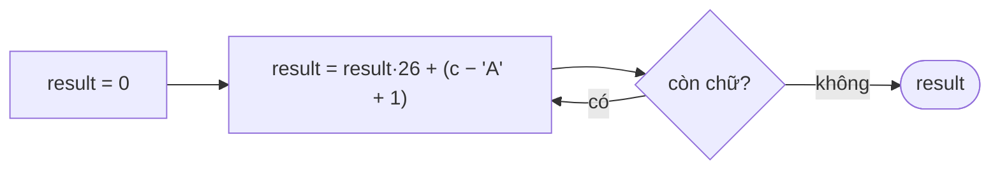

<!-- approaches: Left to right base 26 · Right to left with powers -->
# 171. Excel Sheet Column Number

**Easy** · Math · String · [LeetCode ↗](https://leetcode.com/problems/excel-sheet-column-number/) · Code: [ExcelSheetColumnNumber.java](ExcelSheetColumnNumber.java) · Tests: [ExcelSheetColumnNumberTest.java](ExcelSheetColumnNumberTest.java)

## Đề bài

Đổi tên cột Excel sang số thứ tự: `A → 1`, `Z → 26`, `AA → 27`, `AB → 28`, …

## Ý tưởng

> Đây là hệ **cơ số 26**, chữ số chạy từ **1 tới 26** (không có chữ số 0). Đọc từ trái sang phải giống đọc số thập phân:
> `result = result · 26 + giá trị chữ`.

| chữ | giá trị | result |
|---|---|---|
| Z | 26 | 26 |
| Y | 25 | 26·26 + 25 = **701** |

## Cách 1 — Horner từ trái sang ⭐

## Cách 2 — Từ phải sang, nhân lũy thừa 26

`ZY = 26·26¹ + 25·26⁰`.

## Bẫy & lưu ý

- Chiều ngược lại (168 Excel Sheet Column Title) khó hơn vì không có chữ số 0: phải `n−−` trước khi lấy `n % 26`.

## Bài liên quan

168 Excel Sheet Column Title · 13 Roman to Integer · 8 String to Integer.
