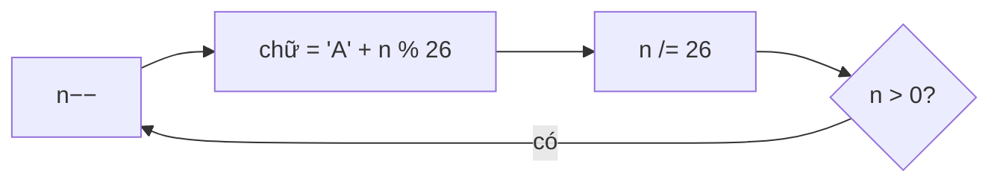

<!-- approaches: Bijective base 26 (subtract 1 before each digit) · Recursive -->
# 168. Excel Sheet Column Title

**Easy** · Math · String · [LeetCode ↗](https://leetcode.com/problems/excel-sheet-column-title/) · Code: [ExcelSheetColumnTitle.java](ExcelSheetColumnTitle.java) · Tests: [ExcelSheetColumnTitleTest.java](ExcelSheetColumnTitleTest.java)

## Đề bài

Đổi số thứ tự cột sang tên cột Excel: `1 → A`, `26 → Z`, `27 → AA`, `701 → ZY`.

## Ý tưởng

> Giống đổi sang cơ số 26, nhưng chữ số chạy **1…26** (không có chữ số 0) — gọi là **cơ số song ánh**. Nếu làm như đổi cơ số thường, `26 % 26 = 0` không có chữ cái tương ứng.
> Mẹo: **trừ 1 trước** mỗi bước để đưa về `0…25`, rồi mới lấy dư và chia.

`701`:

| n | n − 1 | (n−1) % 26 | chữ | (n−1) / 26 |
|---|---|---|---|---|
| 701 | 700 | 24 | Y | 26 |
| 26 | 25 | 25 | Z | 0 |

→ đọc ngược: **ZY**.

## Cách 1 — Vòng lặp ⭐

## Cách 2 — Đệ quy

## Bài liên quan

171 Excel Sheet Column Number (chiều ngược lại) · 405 Convert a Number to Hexadecimal · 12 Integer to Roman.
