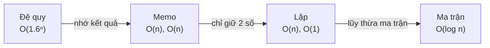

<!-- approaches: Recursion · Memoization · Iterative · Matrix power -->
# 509. Fibonacci Number

**Easy** · Math · Dynamic Programming · Recursion · Memoization · [LeetCode ↗](https://leetcode.com/problems/fibonacci-number/) · Code: [FibonacciNumber.java](FibonacciNumber.java) · Tests: [FibonacciNumberTest.java](FibonacciNumberTest.java)

## Đề bài

`F(0) = 0, F(1) = 1, F(n) = F(n−1) + F(n−2)`. Tính `F(n)`.

## Ý tưởng

> Bài mẫu để so sánh **bốn mức tối ưu** của cùng một công thức truy hồi — từ lũy thừa xuống logarit.



## Cách 1 — Đệ quy thuần

Mỗi lời gọi sinh hai lời gọi; `F(30)` tốn ~2.7 triệu lần gọi.

## Cách 2 — Có nhớ `O(n)`

## Cách 3 — Hai biến `O(n) · O(1)` ⭐

| i | a = F(i) | b = F(i+1) |
|---|---|---|
| 0 | 0 | 1 |
| 1 | 1 | 1 |
| 2 | 1 | 2 |
| 3 | 2 | 3 |
| 4 | **3** | 5 |

## Cách 4 — Lũy thừa ma trận `O(log n)`

```
| 1 1 |ⁿ   | F(n+1)  F(n)   |
| 1 0 |  = | F(n)    F(n−1) |
```

Lũy thừa nhanh: bình phương liên tục, nhân vào kết quả khi bit tương ứng của `n` là 1. Cần khi `n` rất lớn (thường kèm `mod 10⁹+7`).

## Bài liên quan

70 Climbing Stairs · 1137 N-th Tribonacci Number · 509 là phiên bản "trần" của mọi bài DP một chiều.
