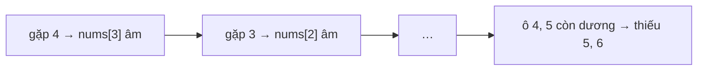

<!-- approaches: Hash set · Mark visited by negating · Cyclic sort -->
# 448. Find All Numbers Disappeared in an Array

**Easy** · Array · Hash Table · [LeetCode ↗](https://leetcode.com/problems/find-all-numbers-disappeared-in-an-array/) · Code: [FindAllNumbersDisappearedInAnArray.java](FindAllNumbersDisappearedInAnArray.java) · Tests: [FindAllNumbersDisappearedInAnArrayTest.java](FindAllNumbersDisappearedInAnArrayTest.java)

## Đề bài

Mảng `n` số, mỗi số trong `[1, n]` (có thể lặp). Liệt kê các số trong `[1, n]` **không xuất hiện**. Follow-up: không dùng bộ nhớ phụ.

```
[4,3,2,7,8,2,3,1] -> [5,6]
```

## Ý tưởng

> Giá trị nằm trong `[1, n]` và mảng dài đúng `n` → **mỗi giá trị `v` có sẵn một ô riêng là `nums[v−1]`**. Dùng chính mảng làm bảng đánh dấu.
> Đánh dấu bằng cách **đổi dấu** (số âm = "đã gặp"), vẫn đọc được giá trị gốc qua `abs`.



| chỉ số | 0 | 1 | 2 | 3 | 4 | 5 | 6 | 7 |
|---|---|---|---|---|---|---|---|---|
| sau đánh dấu | −4 | −3 | −2 | −7 | **8** | **2** | −3 | −1 |

## Cách 1 — HashSet `O(n) · O(n)`

## Cách 2 — Đánh dấu bằng dấu âm `O(n) · O(1)` ⭐

Luôn dùng `abs(x)` khi đọc, vì ô đó có thể đã bị đổi dấu trước đó.

## Cách 3 — Cyclic sort

Hoán đổi mỗi giá trị `v` về đúng ô `v − 1` của nó. Sau đó ô nào không chứa đúng `i + 1` thì `i + 1` bị thiếu. Mỗi lần hoán đổi đặt **ít nhất một** số vào đúng chỗ → tối đa `n` lần, tổng `O(n)`.
Khuôn **cyclic sort** dùng lại ở 41 First Missing Positive, 442 Find All Duplicates, 287.

## Bẫy & lưu ý

- Cách 2 và 3 **sửa mảng đầu vào** — hỏi trước, hoặc khôi phục dấu sau khi xong.

## Bài liên quan

268 Missing Number · 442 Find All Duplicates in an Array · 41 First Missing Positive · 645 Set Mismatch.
