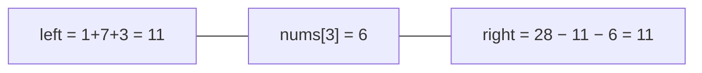

<!-- approaches: Prefix array · Running left sum vs total -->
# 724. Find Pivot Index

**Easy** · Array · Prefix Sum · [LeetCode ↗](https://leetcode.com/problems/find-pivot-index/) · Code: [FindPivotIndex.java](FindPivotIndex.java) · Tests: [FindPivotIndexTest.java](FindPivotIndexTest.java)

## Đề bài

**Chỉ số trụ**: tổng các số bên **trái** (không tính nó) bằng tổng các số bên **phải**. Trả về chỉ số trụ trái nhất, không có → `−1`.

```
[1,7,3,6,5,6] -> 3     1+7+3 = 11 = 5+6
```

## Ý tưởng

> Biết **tổng toàn mảng** và **tổng bên trái** thì suy ra tổng bên phải: `right = total − left − nums[i]`.
> Một lượt tính `total`, một lượt cộng dồn `left` và so sánh.



| i | nums[i] | left | right = 28 − left − nums[i] |
|---|---|---|---|
| 0 | 1 | 0 | 27 |
| 1 | 7 | 1 | 20 |
| 2 | 3 | 8 | 17 |
| 3 | 6 | 11 | **11** ✓ |

## Cách 1 — Mảng prefix sum `O(n) · O(n)`

## Cách 2 — Tổng + tổng trái chạy `O(n) · O(1)` ⭐

So sánh **trước** khi cộng `nums[i]` vào `left` (vì phần tử trụ không thuộc bên nào).

## Bẫy & lưu ý

- Chỉ số 0 có tổng trái = 0; chỉ số cuối có tổng phải = 0.
- Có số âm nên không thể dùng hai con trỏ "dồn về giữa".

## Bài liên quan

303 Range Sum Query · 1991 Find the Middle Index in Array (giống hệt) · 238 Product of Array Except Self · 560 Subarray Sum Equals K.
