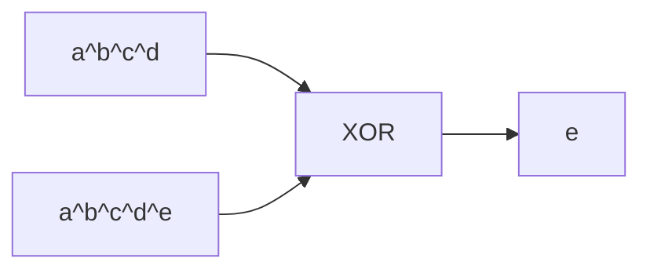

<!-- approaches: Count letters · Sum of codes · XOR -->
# 389. Find the Difference

**Easy** · Hash Table · String · Bit Manipulation · Sorting · [LeetCode ↗](https://leetcode.com/problems/find-the-difference/) · Code: [FindTheDifference.java](FindTheDifference.java) · Tests: [FindTheDifferenceTest.java](FindTheDifferenceTest.java)

## Đề bài

`t` là `s` bị xáo trộn và **thêm một chữ cái**. Tìm chữ được thêm.

```
s = "abcd", t = "abcde" -> 'e'
```

## Ý tưởng

> Mọi chữ của `s` đều có "cặp" trong `t`, chỉ thừa một chữ. Giống 136 Single Number: **XOR** (hoặc trừ tổng) tất cả để các cặp tự triệt tiêu.



## Cách 1 — Đếm chữ cái `O(n)`

## Cách 2 — Hiệu tổng mã ký tự `O(n)` ⭐

`Σ t − Σ s` = mã của chữ thừa. Không tràn: tối đa 1001 ký tự × 122.

## Cách 3 — XOR `O(n)`

## Bài liên quan

136 Single Number · 268 Missing Number · 242 Valid Anagram.
