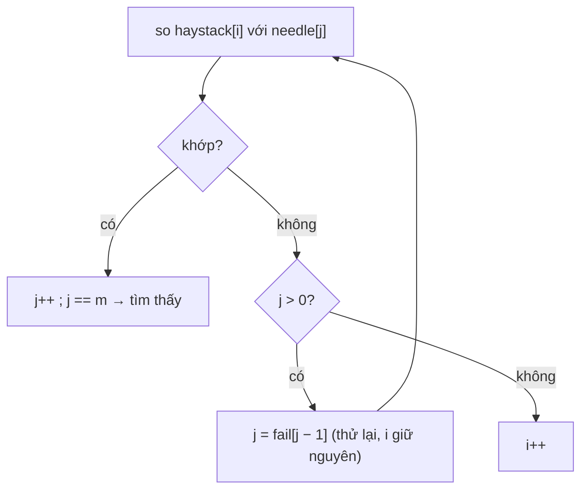

<!-- approaches: Brute force window compare · KMP · Rabin-Karp rolling hash -->
# 28. Find the Index of the First Occurrence in a String

**Easy** · Two Pointers · String · String Matching · Z Algorithm · [LeetCode ↗](https://leetcode.com/problems/find-the-index-of-the-first-occurrence-in-a-string/) · Code: [FindTheIndexOfTheFirstOccurrenceInAString.java](FindTheIndexOfTheFirstOccurrenceInAString.java) · Tests: [FindTheIndexOfTheFirstOccurrenceInAStringTest.java](FindTheIndexOfTheFirstOccurrenceInAStringTest.java)

## Đề bài

Tìm vị trí xuất hiện **đầu tiên** của `needle` trong `haystack` (không có → `−1`).

```
("sadbutsad", "sad") -> 0
```

## Ý tưởng — KMP

> Vét cạn so lại từ đầu mỗi lần lệch → `O(m·n)` với dữ liệu kiểu `"aaaa…ab"`. **KMP** dùng thông tin đã khớp: khi lệch ở vị trí `j` của mẫu, phần đã khớp `needle[0..j)` có **biên** dài nhất `fail[j−1]` (tiền tố đồng thời là hậu tố) → nhảy mẫu về đó, **không lùi** con trỏ trên `haystack`.

Bảng `fail` của `"aabaaac"`:

| j | 0 | 1 | 2 | 3 | 4 | 5 | 6 |
|---|---|---|---|---|---|---|---|
| ký tự | a | a | b | a | a | a | c |
| fail | 0 | 1 | 0 | 1 | 2 | 2 | 0 |



## Cách 1 — Vét cạn ⭐ (đủ cho phỏng vấn thường)

## Cách 2 — KMP `O(m + n)`

## Cách 3 — Rabin–Karp

So **hash cuộn** của cửa sổ với hash của mẫu; chỉ so chuỗi khi hash trùng. Trung bình `O(m + n)`, mở rộng tốt cho tìm **nhiều mẫu** cùng lúc.

## Bài liên quan

459 Repeated Substring Pattern · 214 Shortest Palindrome · 686 Repeated String Match · 1392 Longest Happy Prefix.
