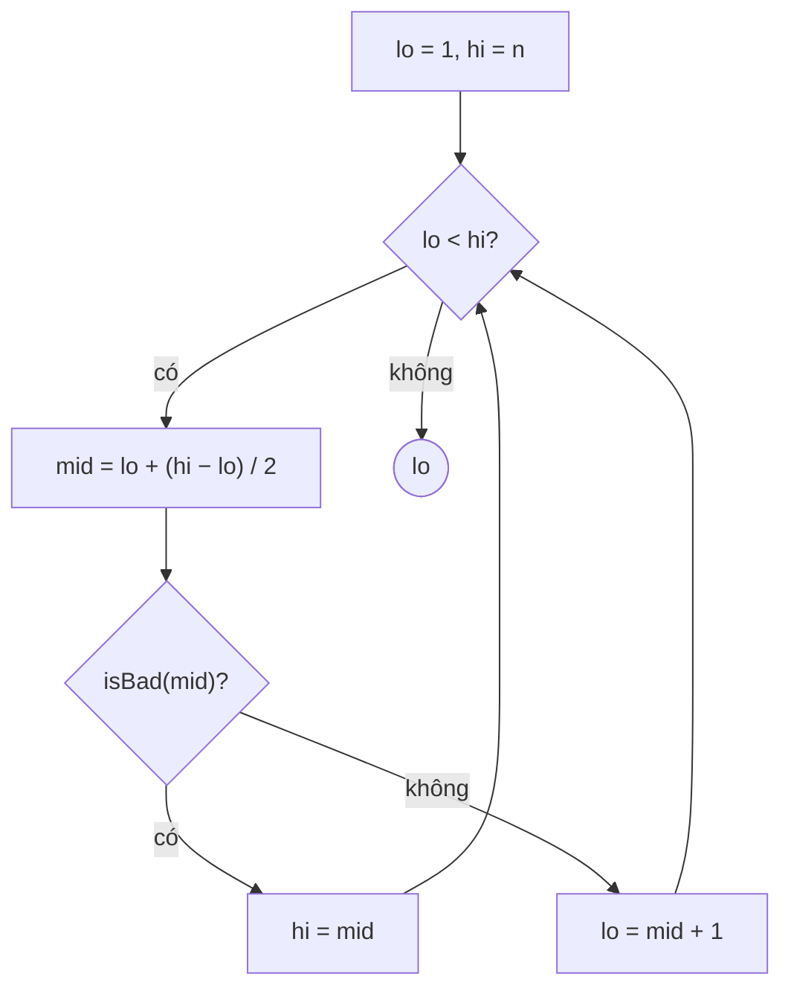

<!-- approaches: Binary search for the first true -->
# 278. First Bad Version

**Easy** · Binary Search · Interactive · [LeetCode ↗](https://leetcode.com/problems/first-bad-version/) · Code: [FirstBadVersion.java](FirstBadVersion.java) · Tests: [FirstBadVersionTest.java](FirstBadVersionTest.java)

## Đề bài

Phiên bản `1…n`; từ phiên bản lỗi đầu tiên trở đi **đều lỗi**. Gọi `isBadVersion(v)` **ít nhất có thể** để tìm phiên bản lỗi đầu tiên.

```
n = 5, lỗi từ 4:   ✓ ✓ ✓ ✗ ✗   -> 4
```

## Ý tưởng

> Dãy kết quả có dạng `[tốt, …, tốt, lỗi, …, lỗi]` — tìm **ranh giới** bằng tìm kiếm nhị phân, khoảng `log₂ n` lần gọi (≤ 31 với `n` = 2³¹ − 1).



| lo | hi | mid | bad? |
|---|---|---|---|
| 1 | 5 | 3 | ✗ → lo = 4 |
| 4 | 5 | 4 | ✓ → hi = 4 |
| 4 | 4 | | → **4** |

## Lời giải ⭐

**Bẫy tràn số:** `(lo + hi) / 2` tràn khi `n` gần `Integer.MAX_VALUE` — test chạy với `n` cực lớn và đếm số lần gọi.

## Bài liên quan

35 Search Insert Position · 374 Guess Number Higher or Lower · 34 Find First and Last Position · 704 Binary Search.
