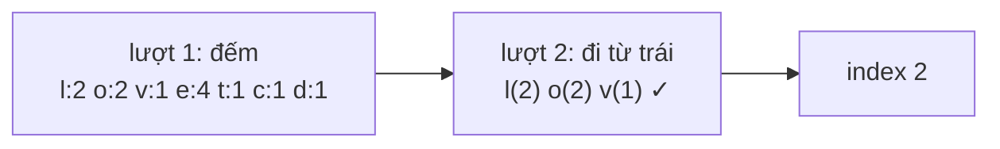

<!-- approaches: Count then scan · First index map · Queue of candidates -->
# 387. First Unique Character in a String

**Easy** · Hash Table · String · Queue · Counting · [LeetCode ↗](https://leetcode.com/problems/first-unique-character-in-a-string/) · Code: [FirstUniqueCharacterInAString.java](FirstUniqueCharacterInAString.java) · Tests: [FirstUniqueCharacterInAStringTest.java](FirstUniqueCharacterInAStringTest.java)

## Đề bài

Tìm chỉ số của ký tự **không lặp đầu tiên**; không có → `−1`.

```
"leetcode" -> 0      "loveleetcode" -> 2 ('v')      "aabb" -> -1
```

## Ý tưởng

> "Không lặp" là thông tin về **cả chuỗi** — chưa đọc hết thì chưa biết. Nên: lượt 1 **đếm**, lượt 2 tìm ký tự đầu tiên có tần suất 1.



## Cách 1 — Đếm rồi quét `O(n)` ⭐

## Cách 2 — Lưu chỉ số đầu tiên

`first[c]` = lần đầu gặp, hoặc `−2` nếu đã lặp. Lượt hai chỉ quét **26 ô** thay vì cả chuỗi — tốt khi chuỗi rất dài.

## Cách 3 — Hàng đợi ứng viên (dữ liệu dạng luồng)

Nếu ký tự đến **từng cái một** và cần trả lời bất cứ lúc nào: giữ hàng đợi các chỉ số chưa lặp; đầu hàng đợi lặp rồi thì bỏ đi. Mỗi chỉ số vào/ra tối đa một lần → `O(n)`.

## Bài liên quan

383 Ransom Note · 242 Valid Anagram · 1429 First Unique Number (thiết kế, dạng luồng).
