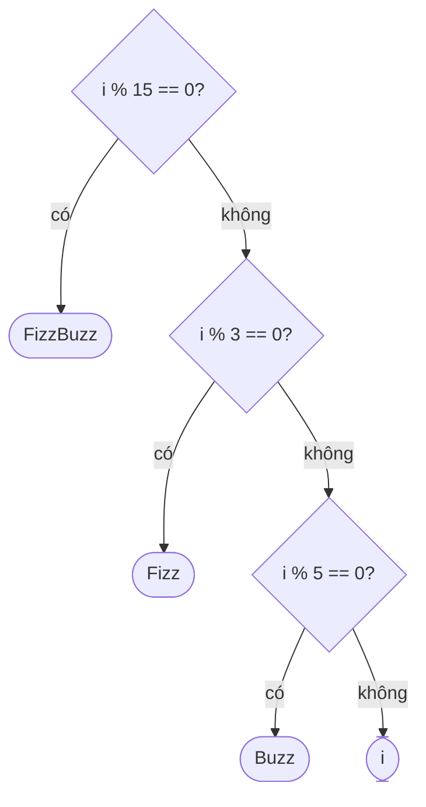

<!-- approaches: Modulo checks · String concatenation · Counters without modulo -->
# 412. Fizz Buzz

**Easy** · Math · String · Simulation · [LeetCode ↗](https://leetcode.com/problems/fizz-buzz/) · Code: [FizzBuzz.java](FizzBuzz.java) · Tests: [FizzBuzzTest.java](FizzBuzzTest.java)

## Đề bài

Với `i` từ 1 tới `n`: chia hết cho cả 3 và 5 → `"FizzBuzz"`, chỉ 3 → `"Fizz"`, chỉ 5 → `"Buzz"`, còn lại → số `i`.

## Ý tưởng

> Thứ tự kiểm tra quan trọng: điều kiện **hẹp nhất** (chia hết cho 15) phải đứng **trước**.

## Cách 1 — Kiểm tra theo thứ tự ⭐

## Cách 2 — Nối chuỗi

`(i%3==0 ? "Fizz" : "") + (i%5==0 ? "Buzz" : "")`. Thêm luật mới ("7 → Jazz") chỉ là thêm một vế — người phỏng vấn hay hỏi đúng câu này để xem code có **mở rộng** được không.

## Cách 3 — Bộ đếm ngược, không dùng phép chia

Hai bộ đếm `fizz`, `buzz` đếm ngược từ 3 và 5; về 0 thì in chữ và đặt lại.

## Bài liên quan

1195 Fizz Buzz Multithreaded · 412 là bài kiểm tra "lọc" cơ bản nhất.
