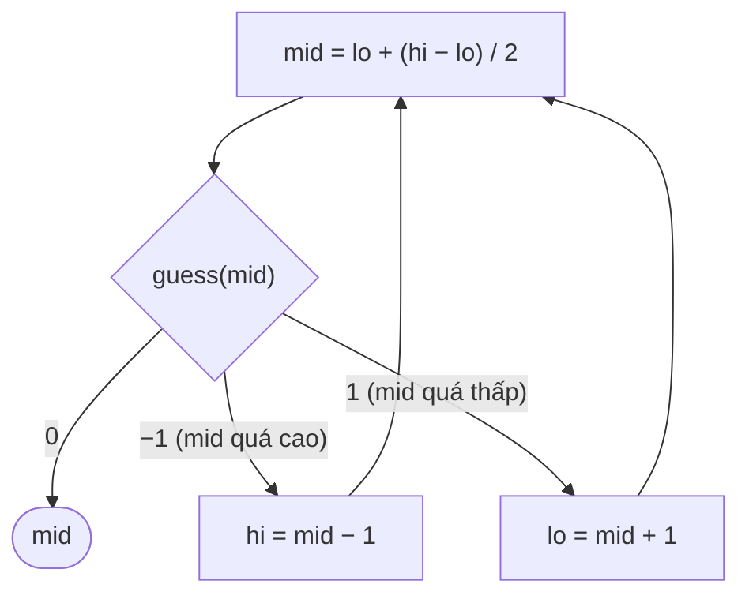

<!-- approaches: Linear guessing · Binary search -->
# 374. Guess Number Higher or Lower

**Easy** · Binary Search · Interactive · [LeetCode ↗](https://leetcode.com/problems/guess-number-higher-or-lower/) · Code: [GuessNumberHigherOrLower.java](GuessNumberHigherOrLower.java) · Tests: [GuessNumberHigherOrLowerTest.java](GuessNumberHigherOrLowerTest.java)

## Đề bài

Trò đoán số `1..n`: `guess(num)` trả `−1` nếu `num` **lớn hơn** số cần tìm, `1` nếu **nhỏ hơn**, `0` nếu đúng.

## Ý tưởng

> Mỗi câu trả lời "cao quá / thấp quá" loại được **một nửa** khoảng còn lại → tìm kiếm nhị phân, tối đa ~31 lần đoán cho `n = 2³¹ − 1`.

## Cách 1 — Đoán lần lượt `O(n)`

## Cách 2 — Tìm kiếm nhị phân `O(log n)` ⭐

## Bẫy & lưu ý

- **Tràn số**: `(lo + hi) / 2` tràn khi `n` gần `Integer.MAX_VALUE` → dùng `lo + (hi − lo) / 2`. Test chạy với `n` cực lớn để bắt lỗi này.
- Đọc kỹ ý nghĩa dấu: `−1` nghĩa là **số mình đoán** cao quá (không phải số cần tìm cao hơn).

## Bài liên quan

704 Binary Search · 278 First Bad Version · 375 Guess Number Higher or Lower II (DP).
