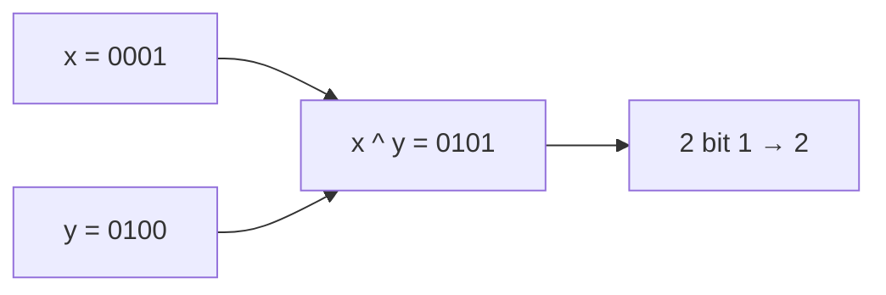

<!-- approaches: XOR + bitCount · XOR + Kernighan · Compare bit by bit -->
# 461. Hamming Distance

**Easy** · Bit Manipulation · [LeetCode ↗](https://leetcode.com/problems/hamming-distance/) · Code: [HammingDistance.java](HammingDistance.java) · Tests: [HammingDistanceTest.java](HammingDistanceTest.java)

## Đề bài

Khoảng cách Hamming = số vị trí bit mà hai số **khác nhau**.

```
1 = 0001
4 = 0100       -> 2 vị trí khác
```

## Ý tưởng

> XOR cho bit `1` **đúng ở những chỗ khác nhau**. Bài trở thành đếm bit 1 của `x ^ y` (bài 191).



## Cách 1 — `Integer.bitCount(x ^ y)` ⭐

## Cách 2 — XOR + Brian Kernighan

Tự đếm bit 1 bằng `z &= z − 1` — người phỏng vấn thường muốn thấy cách này.

## Cách 3 — So từng vị trí `O(32)`

## Bài liên quan

191 Number of 1 Bits · 477 Total Hamming Distance (đếm theo từng cột bit) · 136 Single Number.
