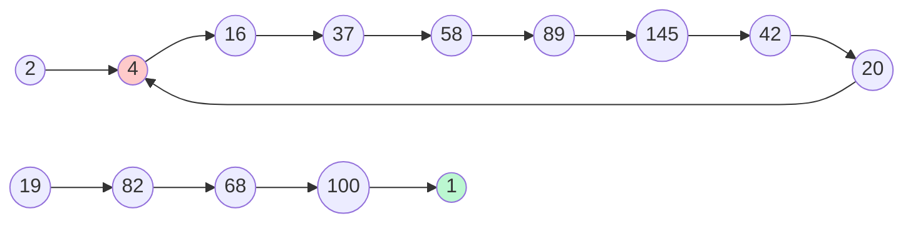

<!-- approaches: Hash set · Floyd cycle detection · Known cycle -->
# 202. Happy Number

**Easy** · Hash Table · Math · Two Pointers · [LeetCode ↗](https://leetcode.com/problems/happy-number/) · Code: [HappyNumber.java](HappyNumber.java) · Tests: [HappyNumberTest.java](HappyNumberTest.java)

## Đề bài

Thay `n` bằng tổng bình phương các chữ số, lặp lại. Nếu tới được `1` → số **vui**; nếu không thì sẽ lặp mãi trong một vòng.

```
19 -> 1² + 9² = 82 -> 8² + 2² = 68 -> 100 -> 1   ✅ true
 2 -> 4 -> 16 -> 37 -> 58 -> 89 -> 145 -> 42 -> 20 -> 4 -> ...   ❌ false
```

## Ý tưởng

> Dãy số tạo thành một **danh sách liên kết ngầm**: mỗi số "trỏ" tới số tiếp theo. Câu hỏi trở thành:
> **danh sách này kết thúc ở 1, hay có chu trình?** — giống hệt bài 141 Linked List Cycle.

Dãy không thể tăng mãi: số có `d` chữ số cho ra tối đa `81·d`, nên mọi số lớn đều nhanh chóng rơi xuống dưới 243.



## Cách 1 — HashSet `O(log n)` bộ nhớ

Lưu mọi số đã gặp; gặp lại một số → có chu trình → `false`.

## Cách 2 — Rùa và thỏ (Floyd) `O(1)` bộ nhớ ⭐

`slow` đi 1 bước, `fast` đi 2 bước. Nếu có chu trình, `fast` sẽ đuổi kịp `slow`; nếu không, `fast` chạm `1` trước.

| bước | slow | fast |
|---|---|---|
| 0 | 2 | 4 |
| 1 | 4 | 37 |
| 2 | 16 | 89 |
| 3 | 37 | 42 |
| 4 | 58 | 4 |
| 5 | 89 | 37 |
| 6 | 145 | 89 |
| 7 | 42 | 42 → **gặp nhau, false** |

## Cách 3 — Chu trình đã biết

Toán học chứng minh mọi số không vui đều rơi vào chu trình chứa `4` → lặp tới khi gặp `1` hoặc `4`. Ngắn nhất nhưng là "mẹo biết trước", nên kể thêm sau khi đã trình bày cách 1/2.

## Bẫy & lưu ý

- Hàm `next` dùng `% 10` và `/ 10`; với `Integer.MAX_VALUE` tổng chỉ ~ 260, không tràn.
- Khởi tạo `fast = next(n)` (không phải `n`) để vòng lặp không dừng ngay từ đầu.

## Bài liên quan

141 Linked List Cycle · 142 Linked List Cycle II · 287 Find the Duplicate Number (Floyd trên mảng).
