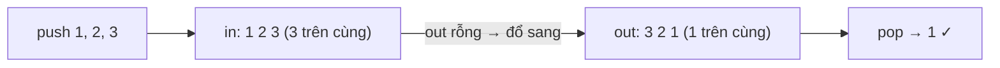

<!-- approaches: Two stacks, lazy transfer · Two stacks, transfer on every push -->
# 232. Implement Queue using Stacks

**Easy** · Stack · Design · Queue · [LeetCode ↗](https://leetcode.com/problems/implement-queue-using-stacks/) · Code: [ImplementQueueUsingStacks.java](ImplementQueueUsingStacks.java) · Tests: [ImplementQueueUsingStacksTest.java](ImplementQueueUsingStacksTest.java)

## Đề bài

Cài đặt **queue** (FIFO) chỉ bằng thao tác **stack**. Follow-up: mỗi thao tác `O(1)` khấu hao.

## Ý tưởng

> Đổ một chồng đĩa sang chồng khác thì thứ tự **đảo ngược** — phần tử vào trước giờ nằm trên cùng.
> Dùng hai stack: `in` nhận phần tử mới, `out` trả phần tử cũ nhất. Chỉ đổ `in` sang `out` khi `out` **rỗng**.

## Cách 1 — Hai stack, đổ lười ⭐

| thao tác | in | out | trả về |
|---|---|---|---|
| push 1, push 2 | 1 2 | | |
| peek | | 2 1 | 1 |
| push 3 | 3 | 2 1 | |
| pop | 3 | 2 | 1 |
| pop | 3 | | 2 |
| pop | | 3 | 3 |

**Vì sao khấu hao `O(1)`?** Mỗi phần tử được push vào `in` một lần, chuyển sang `out` một lần, pop khỏi `out` một lần — tổng 3 thao tác cho mỗi phần tử, bất kể thứ tự gọi.

## Cách 2 — Luôn giữ đúng thứ tự, `push O(n)`

Mỗi lần push, dời hết sang stack phụ, đặt `x` xuống đáy, dời lại. Dễ hiểu nhưng chậm.

## Bẫy & lưu ý

- Không được đổ `in` sang `out` khi `out` **còn** phần tử — sẽ chen phần tử mới lên trước phần tử cũ.

## Bài liên quan

225 Implement Stack using Queues · 155 Min Stack · 622 Design Circular Queue.
