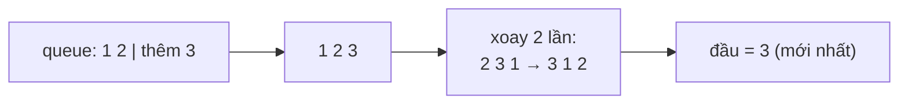

<!-- approaches: Two queues · One queue rotated on push -->
# 225. Implement Stack using Queues

**Easy** · Stack · Design · Queue · [LeetCode ↗](https://leetcode.com/problems/implement-stack-using-queues/) · Code: [ImplementStackUsingQueues.java](ImplementStackUsingQueues.java) · Tests: [ImplementStackUsingQueuesTest.java](ImplementStackUsingQueuesTest.java)

## Đề bài

Cài đặt **stack** (LIFO: `push`, `pop`, `top`, `empty`) chỉ bằng các thao tác của **queue** (FIFO): thêm vào cuối, lấy/xem ở đầu.

## Ý tưởng

> Queue lấy phần tử **cũ nhất**, stack cần phần tử **mới nhất**. Muốn phần tử mới nhất đứng đầu queue thì **xoay** queue: lấy các phần tử cũ ra khỏi đầu và đẩy lại vào cuối.

## Cách 1 — Một queue, xoay khi push ⭐

`push`: thêm vào cuối, rồi chuyển `size − 1` phần tử cũ ra sau nó. Queue luôn giữ thứ tự của stack (đỉnh ở đầu).
`push O(n)`, `pop`/`top O(1)`.

## Cách 2 — Hai queue, push rẻ

`push O(1)`; khi `pop`, chuyển `n − 1` phần tử sang queue phụ, lấy phần tử cuối cùng, rồi đổi vai hai queue. `pop O(n)`.

## Chọn cách nào?

Tuỳ thao tác nào **nhiều hơn**: nhiều `pop`/`top` → cách 1; nhiều `push` → cách 2.

## Bài liên quan

232 Implement Queue using Stacks · 155 Min Stack · 641 Design Circular Deque.
