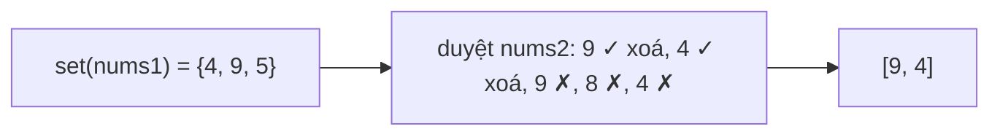

<!-- approaches: Two sets · Sort + two pointers · Sort + binary search -->
# 349. Intersection of Two Arrays

**Easy** · Array · Hash Table · Two Pointers · Binary Search · [LeetCode ↗](https://leetcode.com/problems/intersection-of-two-arrays/) · Code: [IntersectionOfTwoArrays.java](IntersectionOfTwoArrays.java) · Tests: [IntersectionOfTwoArraysTest.java](IntersectionOfTwoArraysTest.java)

## Đề bài

Giao của hai mảng; mỗi giá trị trong kết quả chỉ xuất hiện **một lần**.

```
[4,9,5] ∩ [9,4,9,8,4] -> [9,4]
```

## Ý tưởng

> "Giá trị này có trong mảng kia không?" → **HashSet**. Muốn tiết kiệm bộ nhớ → **sắp xếp** rồi đi hai con trỏ như trộn hai mảng.



## Cách 1 — HashSet `O(m+n)` ⭐

Mẹo: `set.remove(x)` trả `true` lần đầu và `false` các lần sau → vừa kiểm tra vừa khử trùng.

## Cách 2 — Sắp xếp + hai con trỏ

| a (đã sắp) | b (đã sắp) | so sánh |
|---|---|---|
| **4** 5 9 | **4** 4 8 9 9 | bằng → lấy 4 |
| 4 **5** 9 | 4 **4** 8 9 9 | 5 > 4 → j++ |
| 4 **5** 9 | 4 4 **8** 9 9 | 5 < 8 → i++ |
| 4 5 **9** | 4 4 **8** 9 9 | j++ |
| 4 5 **9** | 4 4 8 **9** 9 | bằng → lấy 9 |

## Cách 3 — Sắp xếp mảng nhỏ + tìm kiếm nhị phân

Hợp khi một mảng **rất nhỏ** so với mảng kia.

## Câu hỏi mở rộng

- *Mảng đã sắp xếp sẵn?* → cách 2, `O(1)` bộ nhớ.
- *`nums2` nằm trên đĩa, không đọc hết vào RAM?* → đưa `nums1` vào set, đọc `nums2` theo từng khúc.

## Bài liên quan

350 Intersection of Two Arrays II (giữ số lần lặp) · 160 Intersection of Two Linked Lists.
