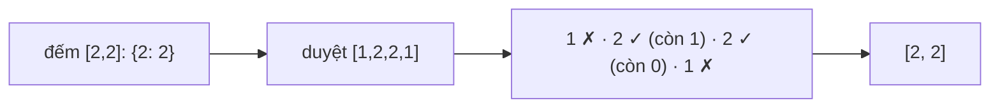

<!-- approaches: Hash map counts · Sort + two pointers -->
# 350. Intersection of Two Arrays II

**Easy** · Array · Hash Table · Two Pointers · Binary Search · [LeetCode ↗](https://leetcode.com/problems/intersection-of-two-arrays-ii/) · Code: [IntersectionOfTwoArraysII.java](IntersectionOfTwoArraysII.java) · Tests: [IntersectionOfTwoArraysIITest.java](IntersectionOfTwoArraysIITest.java)

## Đề bài

Giao của hai mảng, **giữ số lần lặp**: mỗi giá trị xuất hiện `min(số lần trong nums1, số lần trong nums2)` lần.

```
[1,2,2,1] ∩ [2,2] -> [2,2]
```

## Ý tưởng

> Khác 349 ở chỗ phải đếm **số lượng**: đếm mảng nhỏ hơn, rồi duyệt mảng kia, mỗi lần khớp thì "**tiêu**" bớt một.



## Cách 1 — HashMap đếm `O(m+n)` ⭐

Đếm mảng **nhỏ hơn** để bộ nhớ là `O(min(m, n))`.

## Cách 2 — Sắp xếp + hai con trỏ

Như 349 nhưng không bỏ qua giá trị trùng.

## Câu hỏi mở rộng (rất hay được hỏi)

| Tình huống | Cách |
|---|---|
| Hai mảng đã sắp xếp sẵn | Cách 2, không cần sắp xếp → `O(m+n)`, `O(1)` |
| `nums1` rất nhỏ so với `nums2` | Cách 1, đếm `nums1` |
| `nums2` nằm trên đĩa, RAM không đủ | Đếm `nums1` trong RAM, đọc `nums2` theo từng khúc |
| Cả hai đều không vừa RAM | Sắp xếp ngoài (external sort) cả hai rồi trộn |

## Bài liên quan

349 Intersection of Two Arrays · 1002 Find Common Characters.
