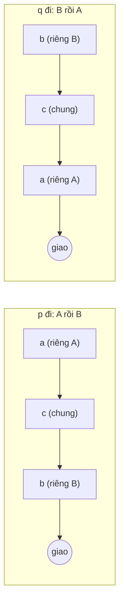

<!-- approaches: Hash set · Length difference · Two pointers switching heads -->
# 160. Intersection of Two Linked Lists

**Easy** · Hash Table · Linked List · Two Pointers · [LeetCode ↗](https://leetcode.com/problems/intersection-of-two-linked-lists/) · Code: [IntersectionOfTwoLinkedLists.java](IntersectionOfTwoLinkedLists.java) · Tests: [IntersectionOfTwoLinkedListsTest.java](IntersectionOfTwoLinkedListsTest.java)

## Đề bài

Hai danh sách liên kết có thể **nhập vào nhau** từ một node trở đi (cùng một đối tượng node). Tìm node đó, không có → `null`. Follow-up: `O(1)` bộ nhớ.

```
A:      4 → 1 ↘
                 8 → 4 → 5
B:  5 → 6 → 1 ↗                 -> node 8
```

## Ý tưởng

> Gọi phần riêng của A dài `a`, phần riêng của B dài `b`, phần chung dài `c`.
> Con trỏ `p` đi hết A rồi **chuyển sang đầu B**; `q` đi hết B rồi chuyển sang đầu A.
> Khi tới điểm giao, cả hai đều đã đi đúng `a + c + b` bước → **gặp nhau đúng ở điểm giao**.



Không giao nhau? Cả hai cùng đi `a + b` bước rồi **cùng gặp `null`** → vòng lặp dừng, trả `null`.

## Cách 1 — HashSet `O(m+n) · O(m)`

Lưu mọi node của A (so theo **đối tượng**, không theo giá trị), đi B tìm node đã gặp.

## Cách 2 — Bù chênh lệch độ dài `O(m+n) · O(1)`

Đo hai độ dài, cho danh sách dài hơn đi trước phần chênh lệch, rồi đi song song tới khi gặp nhau.

## Cách 3 — Hai con trỏ đổi đầu `O(m+n) · O(1)` ⭐

Bốn dòng code, không cần đếm độ dài.

## Bẫy & lưu ý

- So sánh **node** (`p == q`), không so `val`: hai node khác nhau có thể cùng giá trị (ví dụ số `1` trong cả hai danh sách ở trên).

## Bài liên quan

141/142 Linked List Cycle · 1650 Lowest Common Ancestor of a Binary Tree III (cùng mẹo).
