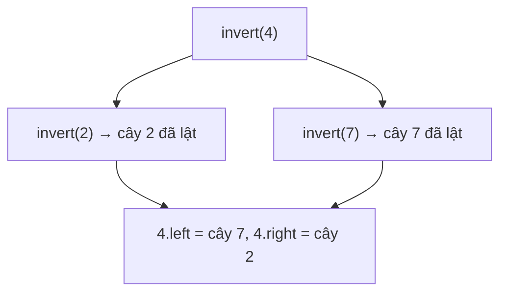

<!-- approaches: Recursive DFS · BFS queue -->
# 226. Invert Binary Tree

**Easy** · Tree · Depth-First Search · Breadth-First Search · Binary Tree · [LeetCode ↗](https://leetcode.com/problems/invert-binary-tree/) · Code: [InvertBinaryTree.java](InvertBinaryTree.java) · Tests: [InvertBinaryTreeTest.java](InvertBinaryTreeTest.java)

## Đề bài

Lật **đối xứng gương** một cây nhị phân: mọi con trái thành con phải và ngược lại.

```
     4                 4
   /   \             /   \
  2     7    =>     7     2
 / \   / \         / \   / \
1   3 6   9       9   6 3   1
```

## Ý tưởng

> Cây lật = gốc giữ nguyên, **hai cây con đổi chỗ**, và mỗi cây con **cũng được lật**. Định nghĩa đệ quy → code đệ quy ba dòng.



## Cách 1 — DFS đệ quy `O(n) · O(h)` ⭐

Lưu ý: phải lưu `left` vào biến tạm **trước** khi ghi đè `root.left`.

## Cách 2 — BFS bằng hàng đợi `O(n)`

Thăm từng node theo tầng, đổi chỗ hai con. Thứ tự thăm không quan trọng — mỗi node chỉ cần được đổi đúng một lần. Dùng khi cây rất sâu (tránh tràn stack).

## Bẫy & lưu ý

- Viết `root.left = invertTree(root.right); root.right = invertTree(root.left);` mà không có biến tạm → cây con trái bị lật **hai lần**.
- Lật hai lần thì về như cũ — test dùng tính chất này.

## Bài liên quan

101 Symmetric Tree · 100 Same Tree · 951 Flip Equivalent Binary Trees.
