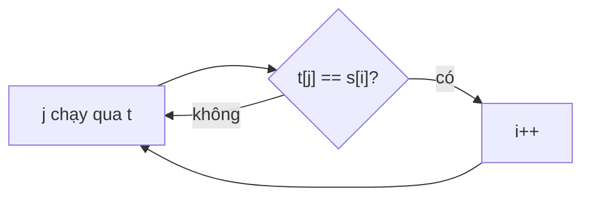

<!-- approaches: Two pointers · Precomputed next-occurrence table (many queries) -->
# 392. Is Subsequence

**Easy** · Two Pointers · String · Dynamic Programming · [LeetCode ↗](https://leetcode.com/problems/is-subsequence/) · Code: [IsSubsequence.java](IsSubsequence.java) · Tests: [IsSubsequenceTest.java](IsSubsequenceTest.java)

## Đề bài

`s` có phải **dãy con** của `t` không (xoá bớt một số ký tự của `t` mà vẫn giữ thứ tự)? Follow-up: rất nhiều chuỗi `s` cùng hỏi trên một `t`.

```
"abc" trong "ahbgdc" -> true      "axc" -> false
```

## Ý tưởng

> **Tham lam:** khớp mỗi ký tự của `s` với lần xuất hiện **sớm nhất** có thể trong `t` — để lại nhiều chỗ nhất cho các ký tự sau.

```
s:  a     b     c
t:  a h b g d c
    ^   ^     ^
```



## Cách 1 — Hai con trỏ `O(|t|)` ⭐

## Cách 2 — Bảng vị trí + tìm kiếm nhị phân (follow-up)

Với hàng tỉ truy vấn: lập danh sách vị trí của từng chữ cái trong `t` **một lần**. Mỗi ký tự của `s`, tìm nhị phân vị trí đầu tiên **sau** lần khớp trước. Mỗi truy vấn chỉ `O(|s| log |t|)`, không phụ thuộc độ dài `t` nữa.

## Bài liên quan

792 Number of Matching Subsequences · 1143 Longest Common Subsequence · 115 Distinct Subsequences.
