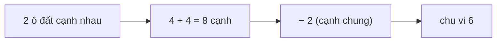

<!-- approaches: Count edges per cell · Count cells and shared edges · DFS -->
# 463. Island Perimeter

**Easy** · Array · Depth-First Search · Breadth-First Search · Matrix · [LeetCode ↗](https://leetcode.com/problems/island-perimeter/) · Code: [IslandPerimeter.java](IslandPerimeter.java) · Tests: [IslandPerimeterTest.java](IslandPerimeterTest.java)

## Đề bài

Lưới có đúng một hòn đảo (các ô `1` nối nhau theo cạnh). Tính **chu vi** của đảo.

```
0 1 0 0
1 1 1 0      -> 16
0 1 0 0
1 1 0 0
```

## Ý tưởng

> Chu vi = số **cạnh ô đất tiếp giáp nước hoặc mép lưới**. Mỗi ô đất có 4 cạnh; cạnh nào kề một ô đất khác thì **không** tính.

## Cách 1 — Đếm cạnh từng ô `O(m·n)` ⭐

Với mỗi ô đất, kiểm tra 4 hướng; hướng nào là nước/ra ngoài lưới → `+1`.

## Cách 2 — Công thức `4·đất − 2·cạnh chung`

Mỗi cạnh chung giữa hai ô đất làm **mỗi ô** mất 1 cạnh chu vi → trừ 2. Chỉ xét láng giềng **trên** và **trái** để mỗi cạnh chung đếm đúng một lần.



Ví dụ trên: 7 ô đất, 6 cạnh chung → `28 − 12 = 16`.

## Cách 3 — DFS

Đi loang từ một ô đất; mỗi lần bước ra nước hoặc ra khỏi lưới là gặp một cạnh chu vi. Hữu ích khi lưới có **nhiều đảo** và cần chu vi từng đảo.

## Bài liên quan

200 Number of Islands · 695 Max Area of Island · 827 Making A Large Island.
