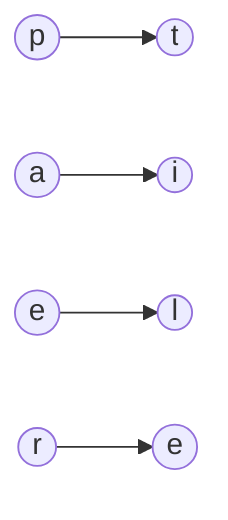

<!-- approaches: Two maps (both directions) · Last-seen position arrays -->
# 205. Isomorphic Strings

**Easy** · Hash Table · String · [LeetCode ↗](https://leetcode.com/problems/isomorphic-strings/) · Code: [IsomorphicStrings.java](IsomorphicStrings.java) · Tests: [IsomorphicStringsTest.java](IsomorphicStringsTest.java)

## Đề bài

Hai chuỗi **đẳng cấu** nếu thay các ký tự của `s` một cách **nhất quán, một-đối-một** thì được `t`.

```
egg ~ add  (e→a, g→d)      foo ≁ bar (o không thể thành cả a và r)      badc ≁ baba (a và c cùng thành a)
```

## Ý tưởng

> Cần ánh xạ **hai chiều**: `s → t` phải nhất quán (một ký tự không thành hai ký tự khác nhau), và `t → s` cũng vậy (hai ký tự không cùng thành một). Chỉ kiểm tra một chiều sẽ sai với `"badc"`/`"baba"`.



## Cách 1 — Hai HashMap ⭐

## Cách 2 — Vị trí xuất hiện gần nhất

Hai chuỗi đẳng cấu ⇔ tại mọi `i`, `s[i]` và `t[i]` có **cùng "lịch sử"**: lần xuất hiện trước của chúng ở cùng vị trí. Hai mảng 256 ô, không cần map.

## Bài liên quan

290 Word Pattern · 890 Find and Replace Pattern · 49 Group Anagrams.
