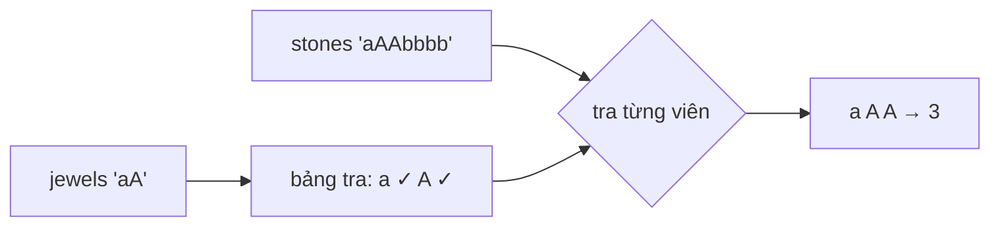

<!-- approaches: Nested scan · Hash set · Boolean table -->
# 771. Jewels and Stones

**Easy** · Hash Table · String · [LeetCode ↗](https://leetcode.com/problems/jewels-and-stones/) · Code: [JewelsAndStones.java](JewelsAndStones.java) · Tests: [JewelsAndStonesTest.java](JewelsAndStonesTest.java)

## Đề bài

`jewels` là các loại đá quý, `stones` là đá bạn có. Bạn có bao nhiêu viên là đá quý? Phân biệt hoa/thường.

```
jewels = "aA", stones = "aAAbbbb" -> 3
```

## Ý tưởng

> Câu hỏi lặp đi lặp lại: "ký tự này có phải đá quý không?" → đưa `jewels` vào một cấu trúc tra cứu `O(1)`.



## Cách 1 — Quét lồng nhau `O(j·s)`

`jewels.indexOf(c)` cho mỗi viên đá.

## Cách 2 — HashSet `O(j + s)`

## Cách 3 — Mảng boolean 128 phần tử `O(j + s)` ⭐

Ký tự là chữ cái ASCII → dùng mã ký tự làm chỉ số. Nhanh hơn HashSet vì không phải đóng hộp `Character`.

## Bẫy & lưu ý

- Phân biệt hoa/thường: `'a'` và `'A'` là hai loại khác nhau — mảng 128 xử lý tự nhiên.

## Bài liên quan

383 Ransom Note · 1832 Check if the Sentence Is Pangram.
