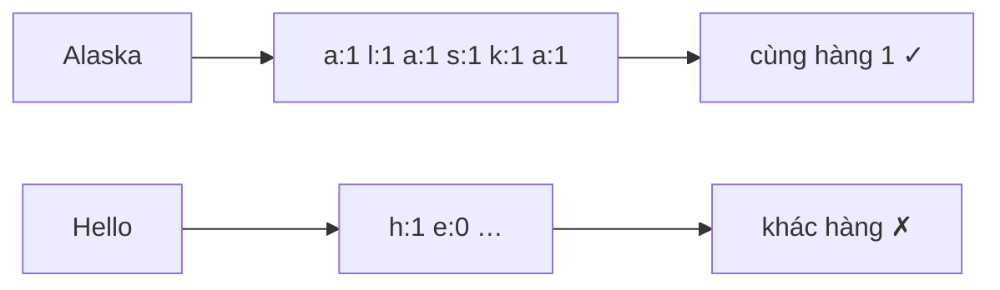

<!-- approaches: Row lookup table · Regex -->
# 500. Keyboard Row

**Easy** · Array · Hash Table · String · [LeetCode ↗](https://leetcode.com/problems/keyboard-row/) · Code: [KeyboardRow.java](KeyboardRow.java) · Tests: [KeyboardRowTest.java](KeyboardRowTest.java)

## Đề bài

Giữ lại những từ gõ được chỉ bằng **một hàng** phím (`qwertyuiop`, `asdfghjkl`, `zxcvbnm`), không phân biệt hoa thường.

```
["Hello","Alaska","Dad","Peace"] -> ["Alaska","Dad"]
```

## Ý tưởng

> Lập bảng **chữ cái → số hàng** một lần. Mỗi từ: mọi chữ phải cùng hàng với chữ đầu tiên.



## Cách 1 — Bảng tra hàng `O(tổng ký tự)` ⭐

## Cách 2 — Regex

`[qwertyuiop]*|[asdfghjkl]*|[zxcvbnm]*` — ngắn nhưng chậm hơn và khó debug.

## Bài liên quan

1662 Check If Two String Arrays are Equivalent · 1160 Find Words That Can Be Formed by Characters.
