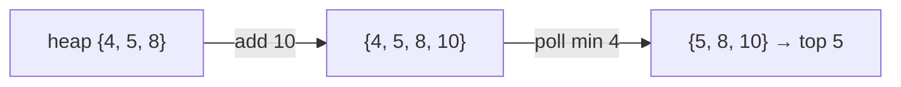

<!-- approaches: Sorted list · Min-heap of size k -->
# 703. Kth Largest Element in a Stream

**Easy** · Tree · Design · Binary Search Tree · Heap (Priority Queue) · [LeetCode ↗](https://leetcode.com/problems/kth-largest-element-in-a-stream/) · Code: [KthLargestElementInAStream.java](KthLargestElementInAStream.java) · Tests: [KthLargestElementInAStreamTest.java](KthLargestElementInAStreamTest.java)

## Đề bài

Thiết kế lớp nhận một **luồng** điểm số; mỗi lần `add(val)` trả về điểm **lớn thứ k** tính tới hiện tại.

```
k = 3, nums = [4,5,8,2]
add(3) -> 4    add(5) -> 5    add(10) -> 5    add(9) -> 8    add(4) -> 8
```

## Ý tưởng

> Chỉ cần giữ **k số lớn nhất**; trong đó số **nhỏ nhất** chính là số lớn thứ k. "Nhỏ nhất trong nhóm" → **min-heap kích thước k**.
> Số mới tới: đẩy vào heap; nếu heap vượt `k` phần tử thì bỏ số nhỏ nhất — nó sẽ không bao giờ là số lớn thứ k nữa.



| add | heap sau | trả về |
|---|---|---|
| (khởi tạo) | 4 5 8 | |
| 3 | 4 5 8 | 4 |
| 5 | 5 5 8 | 5 |
| 10 | 5 8 10 | 5 |
| 9 | 8 9 10 | 8 |
| 4 | 8 9 10 | 8 |

## Cách 1 — Min-heap kích thước k ⭐

`add`: `O(log k)`. Bộ nhớ `O(k)` dù luồng dài vô hạn.

## Cách 2 — Danh sách sắp xếp

Chèn đúng chỗ bằng tìm kiếm nhị phân, nhưng dời phần tử vẫn tốn `O(n)`.

## Bẫy & lưu ý

- `nums` ban đầu có thể ít hơn `k` phần tử — đề đảm bảo khi gọi `add` thì đã có đủ ít nhất `k`.

## Bài liên quan

215 Kth Largest Element in an Array · 347 Top K Frequent Elements · 295 Find Median from Data Stream (Hard, hai heap).
