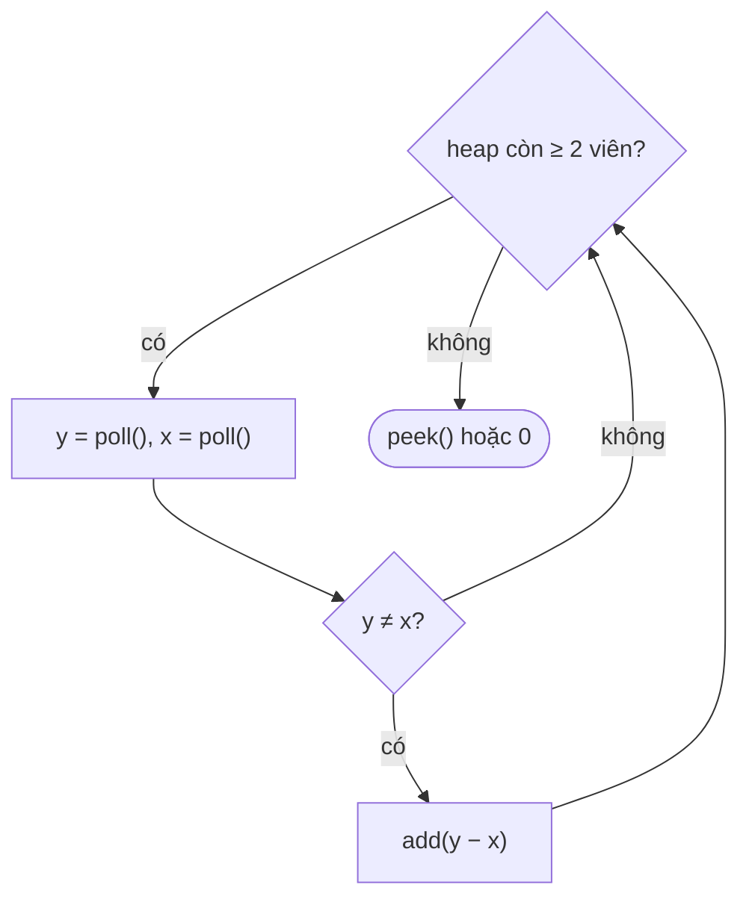

<!-- approaches: Sort every round · Max-heap · Counting by weight -->
# 1046. Last Stone Weight

**Easy** · Array · Heap (Priority Queue) · [LeetCode ↗](https://leetcode.com/problems/last-stone-weight/) · Code: [LastStoneWeight.java](LastStoneWeight.java) · Tests: [LastStoneWeightTest.java](LastStoneWeightTest.java)

## Đề bài

Mỗi lượt lấy hai viên **nặng nhất** `x ≤ y` đập vào nhau: bằng nhau thì cả hai vỡ, không thì còn lại viên nặng `y − x`. Trả về khối lượng viên cuối cùng (hoặc 0).

```
[2,7,4,1,8,1] -> 8 vs 7 → 1 · 4 vs 2 → 2 · 2 vs 1 → 1 · 1 vs 1 → 0 · còn [1] -> 1
```

## Ý tưởng

> Cứ liên tục cần "**lấy phần tử lớn nhất**" trên một tập luôn thay đổi → **max-heap** (`PriorityQueue` với thứ tự ngược).



## Cách 1 — Sắp xếp mỗi lượt `O(n² log n)`

## Cách 2 — Max-heap `O(n log n)` ⭐

Mỗi `poll`/`add` là `O(log n)`, tối đa `n` lượt.

| heap (giảm dần) | đập | còn |
|---|---|---|
| 8 7 4 2 1 1 | 8, 7 | 1 |
| 4 2 1 1 1 | 4, 2 | 2 |
| 2 1 1 1 | 2, 1 | 1 |
| 1 1 1 | 1, 1 | – |
| 1 | | **1** |

## Cách 3 — Đếm theo khối lượng `O(n + W)`

Khối lượng ≤ 1000 → mảng đếm. Đi từ khối lượng lớn xuống; viên mới `w − x` luôn **nhẹ hơn** `w` nên con trỏ không bao giờ phải quay lên. Nhanh khi `n` rất lớn và `W` nhỏ.

## Bẫy & lưu ý

- `new PriorityQueue<>()` mặc định là **min-heap** — phải truyền `Collections.reverseOrder()`.

## Bài liên quan

215 Kth Largest Element in an Array · 703 Kth Largest Element in a Stream · 1049 Last Stone Weight II (DP, khó hơn hẳn).
