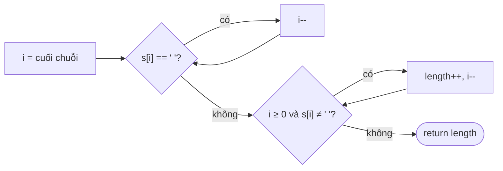

<!-- approaches: Split · Trim + lastIndexOf · Scan from the end -->
# 58. Length of Last Word

**Easy** · String · [LeetCode ↗](https://leetcode.com/problems/length-of-last-word/) · Code: [LengthOfLastWord.java](LengthOfLastWord.java) · Tests: [LengthOfLastWordTest.java](LengthOfLastWordTest.java)

## Đề bài

Chuỗi gồm các từ và dấu cách; trả về độ dài **từ cuối cùng**.

```
"Hello World"                 -> 5
"   fly me   to   the moon  " -> 4   (dấu cách thừa ở cuối)
```

## Ý tưởng

> Từ cuối nằm ở **cuối chuỗi** → đọc ngược từ phải sang, bỏ qua dấu cách thừa rồi đếm chữ.

## Cách 1 — `split` `O(n) · O(n)`

`s.trim().split("\\s+")` rồi lấy phần tử cuối. Ngắn nhưng tạo cả mảng từ chỉ để lấy một từ.

## Cách 2 — `trim` + `lastIndexOf` `O(n) · O(n)`

Độ dài = `t.length() − t.lastIndexOf(' ') − 1`. Không có dấu cách → `lastIndexOf` trả −1 → ra đúng cả chuỗi.

## Cách 3 — Quét từ cuối `O(1)` bộ nhớ ⭐



```
"  fly me   to   the moon  "
                    ^^^^ ^^  <- bỏ 2 dấu cách cuối, đếm "moon" = 4, gặp ' ' thì dừng
```

Chỉ đọc phần đuôi cần thiết — không duyệt cả chuỗi.

## Bẫy & lưu ý

- Dấu cách ở **cuối** chuỗi là bẫy chính.
- Chuỗi chỉ một từ không có dấu cách → vòng thứ hai chạy tới `i = −1`, phải kiểm tra `i >= 0`.

## Bài liên quan

151 Reverse Words in a String · 557 Reverse Words in a String III · 434 Number of Segments in a String.
